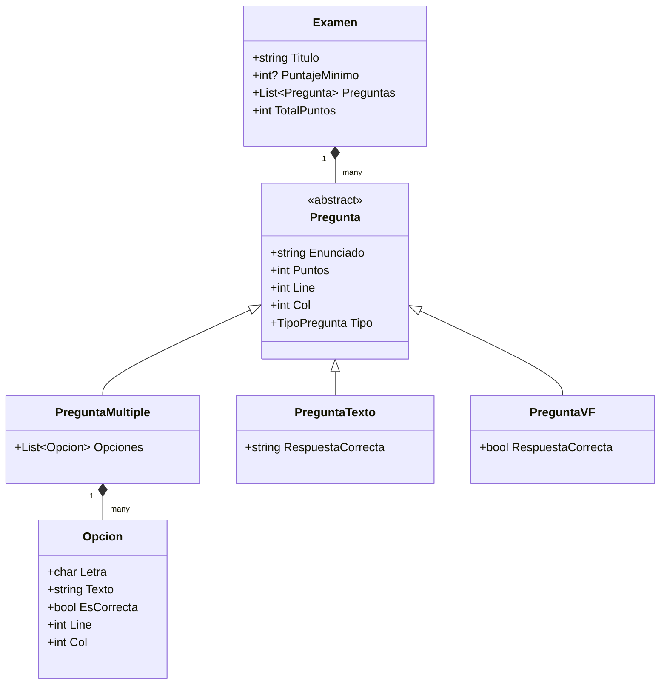
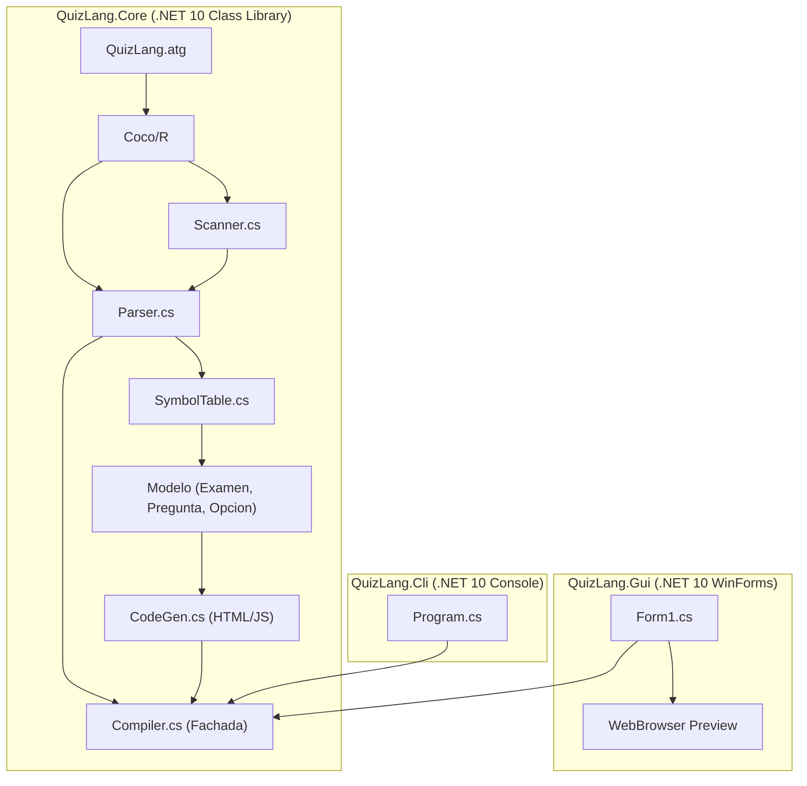

# Documento de Diseño del Compilador QuizLang

**Cátedra:** Compiladores 2026  
**Autores:** Albornoz Joaquín, Díaz Guadalupe, Gallardo Mateo, Reinoso Abel  
**Tecnología:** C# (.NET 10), Coco/R  

---

## 1. Introducción y Alcance

QuizLang es un lenguaje de dominio específico (DSL) diseñado para la especificación formal de exámenes interactivos y autoevaluaciones. El compilador de QuizLang traduce el código fuente `.quiz` a una página web interactiva autocontenida (`HTML5 + CSS3 + JavaScript`), permitiendo responder el examen en cualquier navegador y obtener corrección instantánea, cálculo de puntaje y verificación de aprobación.

El compilador está construido sobre la herramienta **Coco/R** para C#, la cual genera un analizador léxico (Scanner) y un analizador sintáctico descendente recursivo (Parser) regido por una gramática atribuida **LL(1)**.

---

## 2. Especificación Léxica

El análisis léxico descompone el flujo continuo de caracteres en unidades léxicas con significado (tokens), ignorando comentarios y espacios en blanco.

### 2.1. Conjuntos de Caracteres (`CHARACTERS`)
En Coco/R, los conjuntos de caracteres definen el alfabeto sobre el cual se construyen los tokens:

```coco
CHARACTERS
  letter     = 'a' .. 'z' + 'A' .. 'Z' .
  digit      = '0' .. '9' .
  cr         = '\r' .
  lf         = '\n' .
  stringChar = ANY - '"' - '\\' - cr - lf .
  printable  = ' ' .. '~' .
```

* `letter`: letras del alfabeto en minúsculas y mayúsculas.
* `digit`: dígitos arábigos estándar.
* `stringChar`: cualquier carácter excepto comillas dobles, barra invertida y saltos de línea.
* `printable`: caracteres ASCII imprimibles estándar utilizados para secuencias de escape.

### 2.2. Definición de Tokens (`TOKENS`)

```coco
TOKENS
  letra  = letter .
  number = digit { digit } .
  string = '"' { stringChar | '\\' printable } '"' .
```

* **`letra`**: representa un único carácter alfabético (usado para identificar alternativas en preguntas de opción múltiple, como `a)`, `b)`).
* **`number`**: secuencia de uno o más dígitos, representando cantidades enteras (puntajes, mínimos).
* **`string`**: cadena literal delimitada por comillas dobles (`"..."`), soportando escapes como `\"`, `\\`, etc.
* **Palabras clave y literales sintácticos**: Coco/R genera tokens literales automáticamente a partir de su uso en la gramática:
  * `"EXAMEN"`
  * `"PUNTAJE_MINIMO"`
  * `"PREGUNTA_MULTIPLE"`
  * `"PUNTOS"`
  * `"{"`, `"}"`
  * `")"`
  * `"[CORRECTA]"`
  * `"PREGUNTA_TEXTO"`
  * `"RESPUESTA"`
  * `"PREGUNTA_VF"`
  * `"="`
  * `"VERDADERO"`, `"FALSO"`

### 2.3. Comentarios y Caracteres Ignorados

```coco
COMMENTS FROM "//" TO "\n"
COMMENTS FROM "/*" TO "*/"
IGNORE ' ' + '\t' + '\r' + '\n'
```

* Se admiten comentarios de una sola línea iniciados por `//` hasta el fin de línea.
* Se admiten comentarios de bloque multilinea delimitados por `/*` y `*/`.
* Se ignoran espacios en blanco, tabulaciones y saltos de línea entre tokens.

---

## 3. Especificación Sintáctica y Propiedad LL(1)

### 3.1. Gramática en Notación EBNF

La gramática formal de QuizLang en EBNF es la siguiente:

```ebnf
QuizLang       = "EXAMEN" string [ Config ] { Pregunta } .
Config         = "PUNTAJE_MINIMO" number .
Pregunta       = Multiple | Texto | VerdaderoFalso .
Multiple       = "PREGUNTA_MULTIPLE" string [ "PUNTOS" number ] "{" Opcion { Opcion } "}" .
Opcion         = letra ")" string [ "[CORRECTA]" ] .
Texto          = "PREGUNTA_TEXTO" string [ "PUNTOS" number ] [ "RESPUESTA" string ] .
VerdaderoFalso = "PREGUNTA_VF" string [ "PUNTOS" number ] "=" ( "VERDADERO" | "FALSO" ) .
```

### 3.2. Justificación de la Propiedad LL(1)

Un analizador sintáctico descendente recursivo con un solo símbolo de anticipación ($k=1$) requiere que para cada decisión de la gramática, los conjuntos de selección sean mutuamente disjuntos.

1. **Regla `QuizLang`**:
   * Símbolo inicial obligatorio: `"EXAMEN"`.
   * Alternativa opcional `[ Config ]`: $\text{FIRST}(Config) = \{\text{"PUNTAJE\_MINIMO"}\}$, mientras que $\text{FIRST}(Pregunta) = \{\text{"PREGUNTA\_MULTIPLE"}, \text{"PREGUNTA\_TEXTO"}, \text{"PREGUNTA\_VF"}\}$ y $\text{FOLLOW}(Config)$ contiene el inicio de `Pregunta` o `EOF`. Como estos conjuntos no comparten elementos, la elección es determinística.
   * Bucle `{ Pregunta }`: se evalúa mientras el lookahead pertenezca a $\text{FIRST}(Pregunta)$. Al encontrar `EOF`, el bucle finaliza sin ambigüedad.

2. **Regla `Pregunta`**:
   * Alternativa 1: `Multiple` $\to \text{FIRST} = \{\text{"PREGUNTA\_MULTIPLE"}\}$
   * Alternativa 2: `Texto` $\to \text{FIRST} = \{\text{"PREGUNTA\_TEXTO"}\}$
   * Alternativa 3: `VerdaderoFalso` $\to \text{FIRST} = \{\text{"PREGUNTA\_VF"}\}$
   * $\text{FIRST}(Multiple) \cap \text{FIRST}(Texto) \cap \text{FIRST}(VerdaderoFalso) = \emptyset$.
   * Las tres alternativas tienen símbolos directores disjuntos, garantizando decisión determinística con $k=1$.

3. **Regla `Multiple`**:
   * `[ "PUNTOS" number ]`: el lookahead `"PUNTOS"` decide inequívocamente la presencia del puntaje frente a `"{"`.
   * En el bloque `"{" Opcion { Opcion } "}"`: $\text{FIRST}(Opcion) = \{\text{letra}\}$. Como el cierre del bloque es `"}"`, y $\text{letra} \cap \{\text{"}"}\} = \emptyset$, el bucle `{ Opcion }` se itera mientras haya una `letra` y finaliza de forma determinista ante `"}"`.

4. **Regla `Opcion`**:
   * El token opcional `[ "[CORRECTA]" ]` tiene como lookahead `"[CORRECTA]"`, mientras que su siguiente símbolo puede ser el inicio de otra `Opcion` (`letra`) o el cierre de bloque `"}"`. Son completamente disjuntos.

5. **Regla `VerdaderoFalso`**:
   * La alternativa terminal $( \text{"VERDADERO"} \mid \text{"FALSO"} )$ tiene conjuntos de anticipación unitarios y disjuntos: $\{\text{"VERDADERO"}\} \cap \{\text{"FALSO"}\} = \emptyset$.

**Conclusión:** La gramática es estrictamente LL(1), no posee ambigüedades, no contiene recursión por izquierda y Coco/R no reporta ningún conflicto ni advertencia.

---

## 4. Análisis Semántico y Tabla de Símbolos

El análisis semántico valida que el examen respete las reglas contextuales y de negocio del lenguaje. Estas comprobaciones están encapsuladas en `SymbolTable.cs` y utilizan `Errors.SemErr` (y `Errors.Warning`) para asociar cada error a su línea y columna de origen.



### 4.1. Chequeos Semánticos Implementados

1. **Enunciados de pregunta duplicados:**
   * Se almacena un conjunto `HashSet<string>` con los enunciados normalizados.
   * Si una pregunta repite el enunciado de una previa (comparación insensible a mayúsculas y espacios extremos), se emite:  
     `linea X col Y: Enunciado de pregunta duplicado: "..."`
2. **Pregunta múltiple con cero o más de una [CORRECTA]:**
   * Se cuenta el número de opciones con `EsCorrecta == true`.
   * Si es 0: `La pregunta múltiple "..." no tiene ninguna opción marcada como [CORRECTA].`
   * Si es mayor a 1: `La pregunta múltiple "..." tiene más de una opción marcada como [CORRECTA] (se encontraron N).`
3. **Letras de opción repetidas dentro de una pregunta:**
   * En cada pregunta múltiple se rastrean las letras utilizadas (`a`, `b`, etc.).
   * Si una letra se repite: `Letra de opción duplicada 'X' en la pregunta "...".`
4. **Letras de opción no consecutivas (Advertencia):**
   * Se verifica que las opciones sigan la secuencia alfabética (`a`, `b`, `c`...).
   * Si se omite una letra, se reporta una advertencia informativa:  
     `linea X col Y: advertencia: Letra de opción no consecutiva: se esperaba 'X' pero se encontró 'Y'.`
5. **PUNTAJE_MINIMO mayor al total de puntos:**
   * Al finalizar el examen, se evalúa si el puntaje mínimo requerido supera la sumatoria de puntos de todas las preguntas:  
     `El puntaje mínimo (X) es mayor al total de puntos del examen (Y).`
6. **Examen sin preguntas:**
   * Al finalizar el análisis, si `Examen.Preguntas.Count == 0`:  
     `El examen no contiene preguntas.`

---

## 5. Generación de Código (`CodeGen.cs`)

El módulo `CodeGen` implementa el backend del compilador, traduciendo el AST validado a una aplicación web cliente pura:

1. **Autocontenido:** Genera un único archivo HTML sin dependencias de librerías externas o CDNs (funciona offline).
2. **Interactividad:**
   * Cada pregunta se estructura en una tarjeta visual (`.pregunta-card`).
   * Botón **"Corregir"**: ejecuta la evaluación en JavaScript.
   * Botón **"Reiniciar"**: limpia selecciones y vuelve al estado inicial.
3. **Lógica de Corrección:**
   * Para preguntas de opción múltiple y V/F, compara la alternativa marcada con la respuesta correcta.
   * Para preguntas de texto libre, aplica normalización eliminando espacios en los extremos y realizando comparación insensible a mayúsculas (`trim().toLowerCase()`).
   * Resalta en color verde las respuestas correctas y en rojo las incorrectas, mostrando la solución esperada.
   * Muestra el resumen global de aprobación según el `PUNTAJE_MINIMO` o umbral del 60%.
4. **Seguridad:** Todos los textos del examen se escapan con `System.Net.WebUtility.HtmlEncode` para prevenir inyección de código.

---

## 6. Arquitectura de la Solución

La solución `QuizLang.sln` se estructura en tres proyectos bajo el estándar `.NET 10`:



* **`QuizLang.Core`**: Núcleo del compilador independiente de plataforma. Contiene el scanner, parser, tabla de símbolos, modelo AST, generador de código y la fachada `Compiler.cs`.
* **`QuizLang.Cli`**: Herramienta de consola para compilación por lotes y automatización.
* **`QuizLang.Gui`**: Entorno de desarrollo integrado gráfico basado en Windows Forms.

---

## 7. Descripción de la Interfaz Gráfica (`QuizLang.Gui`)

`QuizLang.Gui` proporciona una experiencia interactiva para escribir, depurar y previsualizar exámenes:

1. **Editor de Código con Números de Línea:**
   * Área de texto basada en fuente monoespaciada (`Consolas`).
   * Columna izquierda sincronizada con el scroll que dibuja los números de línea en tiempo real.
2. **Barra de Herramientas:**
   * **Abrir... / Guardar / Guardar Como:** gestión de archivos `.quiz`.
   * **Compilar:** dispara la compilación en memoria mediante `Compiler.CompileSource`.
   * **Ver HTML:** abre el resultado generado en el navegador web predeterminado del sistema operativo.
   * **Selector de Ejemplos:** menú desplegable con plantillas predefinidas (Básico, Completo, Compiladores 2026, Errores).
3. **Panel Inferior de Errores y Advertencias:**
   * Tabla con columnas: *Tipo*, *Línea*, *Columna* y *Mensaje*.
   * Las filas de error se colorean en tono rojizo y las advertencias en amarillo suave.
   * **Navegación Interactiva:** hacer doble clic sobre cualquier error resalta y enfoca inmediatamente la línea y columna correspondiente en el editor de texto.
4. **Visor de Vista Previa Integrado:**
   * Panel derecho con control web integrado para interactuar y responder el examen directamente desde el entorno sin salir de la aplicación.
