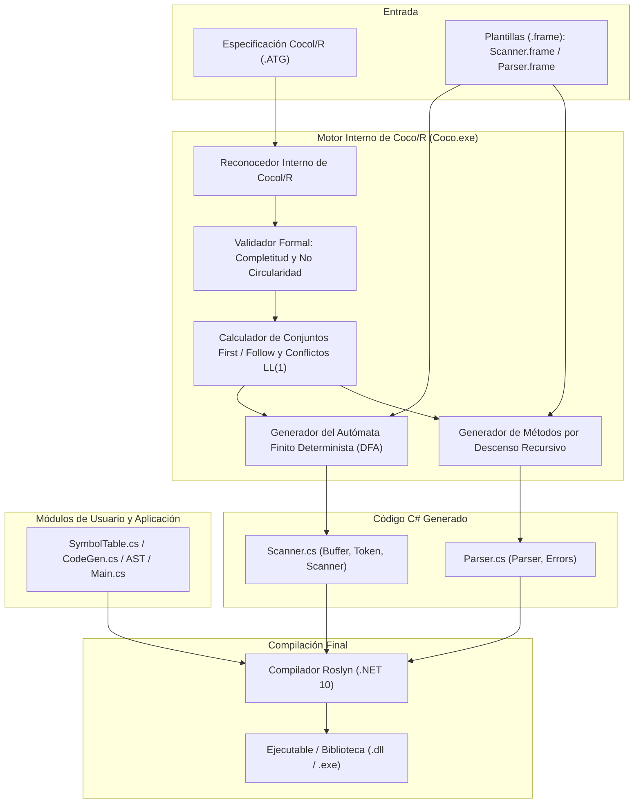
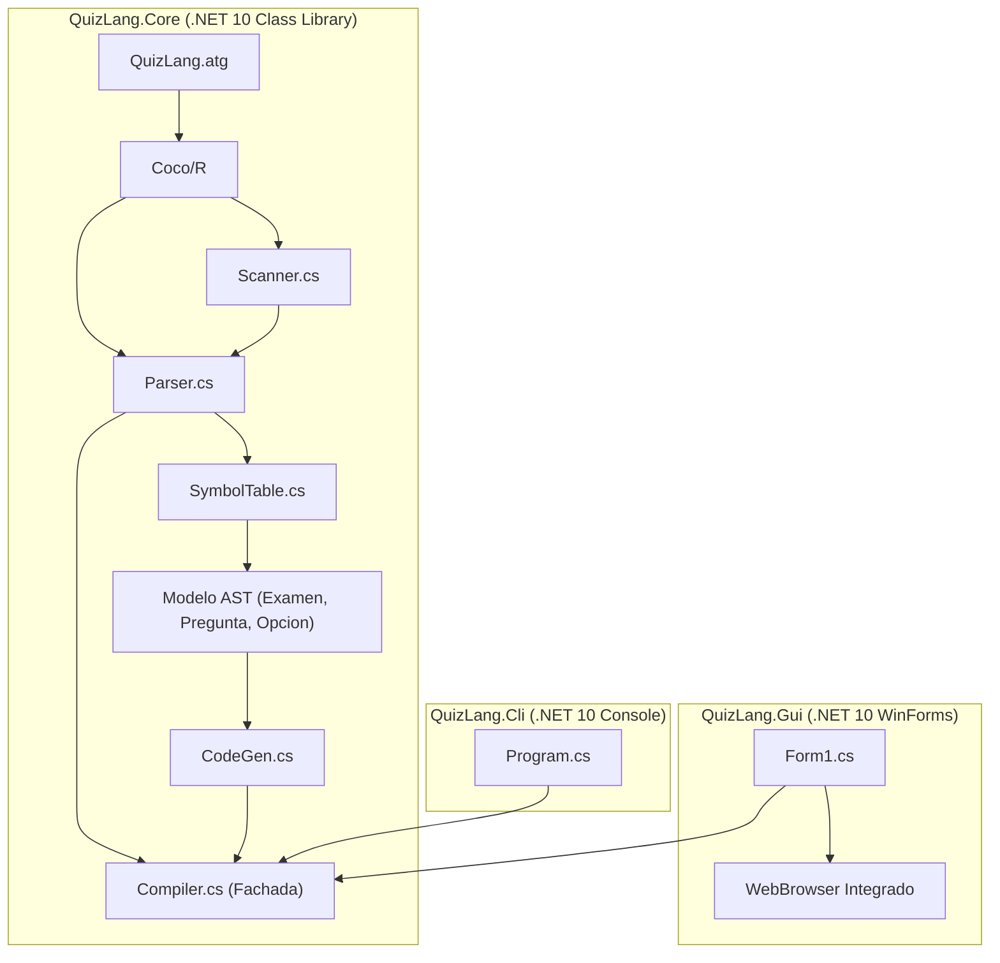

> **Nota para el grupo:** Borrador asistido por IA: revisar, comprender y reescribir con palabras propias antes de entregar.

---

# INFORME FINAL DE TRABAJO PRÁCTICO

## QuizLang: Compilador de Exámenes Interactivos con Generación Web Autocontenida
### Investigación sobre el Generador Coco/R, Caso Taste y Desarrollo de un DSL en .NET 10

---

**Cátedra:** Compiladores  
**Ciclo Lectivo:** 2026  
**Carrera:** Ingeniería en Sistemas de Información / Ciencias de la Computación  
**Integrantes del Grupo:**
* **Albornoz, Joaquín**
* **Díaz, Guadalupe**
* **Gallardo, Mateo**
* **Reinoso, Abel**

---

### Registro Fotográfico del Equipo de Trabajo

  
*(Nota para la entrega: Reemplazar el archivo `foto_grupo.jpg` en la misma carpeta con la fotografía grupal oficial de los 4 integrantes del equipo).*

---

## Índice General

1. [Introducción y Objetivos del Proyecto](#1-introducción-y-objetivos-del-proyecto)
2. [PARTE 1: Investigación Bibliográfica sobre el Generador Coco/R y Marco Teórico](#2-parte-1-investigación-bibliográfica-sobre-el-generador-cocor-y-marco-teórico)
   * [2.1 Introducción a Coco/R](#21-introducción-a-cocor)
     * [2.1.1 Historia y Evolución](#211-historia-y-evolución)
     * [2.1.2 Arquitectura Interna del Generador](#212-arquitectura-interna-del-generador)
     * [2.1.3 Instalación, Configuración y Parámetros de Invocación](#213-instalación-configuración-y-parámetros-de-invocación)
     * [2.1.4 Ejemplo Mínimo de Analizador en Cocol/R](#214-ejemplo-mínimo-de-analizador-en-cocolr)
     * [2.1.5 Análisis de los Archivos Generados (`Scanner.cs` y `Parser.cs`)](#215-análisis-de-los-archivos-generados-scannercs-y-parsercs)
   * [2.2 Conceptos Teóricos Fundamentales](#22-conceptos-teóricos-fundamentales)
     * [2.2.1 Componentes Léxicos, Lexemas y Expresiones Regulares](#221-componentes-léxicos-lexemas-y-expresiones-regulares)
     * [2.2.2 Autómatas Finitos Deterministas (DFA) y su Implementación](#222-autómatas-finitos-deterministas-dfa-y-su-implementación)
     * [2.2.3 Gramáticas Libres de Contexto y Notación EBNF de Wirth](#223-gramáticas-libres-de-contexto-y-notación-ebnf-de-wirth)
     * [2.2.4 Árbol de Análisis Concreto (CST) vs. Sintaxis Abstracta (AST)](#224-árbol-de-análisis-concreto-cst-vs-sintaxis-abstracta-ast)
     * [2.2.5 Análisis Sintáctico por Descenso Recursivo](#225-análisis-sintáctico-por-descenso-recursivo)
     * [2.2.6 La Propiedad LL(1), Detección y Resolución de Conflictos](#226-la-propiedad-ll1-detección-y-resolución-de-conflictos)
     * [2.2.7 Estructura de la Tabla de Símbolos y Ámbitos de Visibilidad](#227-estructura-de-la-tabla-de-símbolos-y-ámbitos-de-visibilidad)
     * [2.2.8 Generación de Código Intermedio y Backpatching](#228-generación-de-código-intermedio-y-backpatching)
   * [2.3 Estudio de Caso Pedagógico: El Compilador e Intérprete TASTE](#23-estudio-de-caso-pedagógico-el-compilador-e-intérprete-taste)
     * [2.3.1 Características del Lenguaje Fuente Taste](#231-características-del-lenguaje-fuente-taste)
     * [2.3.2 Desglose de la Gramática `Taste.ATG`](#232-desglose-de-la-gramática-tasteatg)
     * [2.3.3 La Máquina Virtual de Pila y Repertorio de Opcodes](#233-la-máquina-virtual-de-pila-y-repertorio-de-opcodes)
     * [2.3.4 Mecánica de Backpatching para Control de Flujo](#234-mecánica-de-backpatching-para-control-de-flujo)
     * [2.3.5 Lecciones Aprendidas del Proyecto Taste](#235-lecciones-aprendidas-del-proyecto-taste)
3. [PARTE 2: Estudio de Caso Práctico: El Compilador QuizLang](#3-parte-2-estudio-de-caso-práctico-el-compilador-quizlang)
   * [3.1 Motivación y Dominio del Problema](#31-motivación-y-dominio-del-problema)
   * [3.2 Especificación Formal de QuizLang](#32-especificación-formal-de-quizlang)
   * [3.3 Especificación en Cocol/R: Análisis Detallado de `QuizLang.atg`](#33-especificación-en-cocolr-análisis-detallado-de-quizlangatg)
   * [3.4 Demostración Matemática de la Propiedad LL(1)](#34-demostración-matemática-de-la-propiedad-ll1)
   * [3.5 Análisis Semántico y Tabla de Símbolos (`SymbolTable.cs`)](#35-análisis-semántico-y-tabla-de-símbolos-symboltablecs)
   * [3.6 Generación de Código Web Interactivo (`CodeGen.cs`)](#36-generación-de-código-web-interactivo-codegencs)
   * [3.7 Arquitectura del Sistema e Interfaces](#37-arquitectura-del-sistema-e-interfaces)
     * [3.7.1 Núcleo del Compilador (`QuizLang.Core`)](#371-núcleo-del-compilador-quizlangcore)
     * [3.7.2 Compilador de Línea de Comandos (`QuizLang.Cli`)](#372-compilador-de-línea-de-comandos-quizlangcli)
     * [3.7.3 Entorno de Desarrollo Gráfico (`QuizLang.Gui`)](#373-entorno-de-desarrollo-gráfico-quizlanggui)
   * [3.8 Plan de Verificación y Banco de Pruebas](#38-plan-de-verificación-y-banco-de-pruebas)
   * [3.9 Guía de Compilación, Ejecución y Replicabilidad](#39-guía-de-compilación-ejecución-y-replicabilidad)
4. [PARTE 3: Reflexiones sobre el Uso de la Inteligencia Artificial Generativa](#4-parte-3-reflexiones-sobre-el-uso-de-la-inteligencia-artificial-generativa)
5. [Conclusiones](#5-conclusiones)
6. [Referencias Bibliográficas](#6-referencias-bibliográficas)
7. [Anexos](#7-anexos)
   * [Anexo A: Especificación Gramatical Completa (`QuizLang.atg`)](#anexo-a-especificación-gramatical-completa-quizlangatg)
   * [Anexo B: Manual de Usuario Resumido](#anexo-b-manual-de-usuario-resumido)
   * [Anexo C: Bitácora Unificada de Uso de IA](#anexo-c-bitácora-unificada-de-uso-de-ia)

---

## 1. Introducción y Objetivos del Proyecto

El desarrollo de compiladores constituye uno de los pilares formativos más rigurosos y formativos en la ciencia de la computación. En esta disciplina convergen la teoría formal de autómatas, los modelos matemáticos de lenguajes libres de contexto, las técnicas de análisis sintáctico determinista, el modelado semántico contextual y los paradigmas de generación de código ejecutable.

El presente Trabajo Final de la cátedra **Compiladores 2026** fue estructurado con un doble propósito pedagógico y práctico:
1. **Investigación Teórica Rigurosa:** Analizar en profundidad los fundamentos conceptuales y metodológicos del generador de compiladores **Coco/R**, desarrollado originalmente en el ETH Zürich y la Universidad Johannes Kepler de Linz (Austria), prestando especial atención a su dialecto declarativo Cocol/R, su analizador sintáctico descendente recursivo basado en gramáticas atribuidas $LL(1)$ y el caso de referencia pedagógico **Taste**.
2. **Construcción de un Lenguaje de Dominio Específico (DSL):** Diseñar, formalizar e implementar desde cero un compilador completo denominado **QuizLang**. Este lenguaje permite a docentes y evaluadores definir exámenes técnicos de forma concisa, traduciendo el código fuente `.quiz` a páginas web interactivas autocontenidas (`HTML5 + CSS3 + JavaScript`), permitiendo responder el cuestionario offline y obtener corrección inmediata sin depender de plataformas cerradas ni conectividad a internet.

A lo largo del proyecto, el equipo adoptó un enfoque de desarrollo asistido por **Inteligencia Artificial generativa** bajo una arquitectura de agentes coordinados (**Antigravity** con supervisión de Claude Opus y agentes operativos Gemini Flash), registrando de manera cronológica y transparente cada interacción en una bitácora técnica obligatoria y ejerciendo una supervisión humana crítica sobre cada artefacto generado.

---

## 2. PARTE 1: Investigación Bibliográfica sobre el Generador Coco/R y Marco Teórico

### 2.1 Introducción a Coco/R

#### 2.1.1 Historia y Evolución
El generador de compiladores **Coco/R** (*Compiler Compiler / Recursive descent*) fue creado a finales de la década de 1980 por **Hanspeter Mössenböck** en el *Institut für Computersysteme* de la Escuela Politécnica Federal de Zúrich (ETH Zürich). Su diseño estuvo fuertemente influenciado por las directrices metodológicas de **Niklaus Wirth** (creador de Pascal, Modula-2 y Oberon), orientadas a la simplicidad conceptual, la economía sintáctica y la eficiencia algorítmica.

Frente a la hegemonía de las herramientas del ecosistema UNIX —como **Lex/Yacc** o **Flex/Bison**, basadas en análisis ascendente mediante autómatas $LALR(1)$ guiados por tablas de estados densas—, Mössenböck concibió una herramienta que demostrara las ventajas del **análisis sintáctico por descenso recursivo** (*recursive descent*) sobre **gramáticas atribuidas** (*attributed grammars*) de la clase $LL(1)$. En este enfoque, cada no terminal gramatical se traduce directamente en un método procedural ordinario en el lenguaje destino, posibilitando una depuración paso a paso intuitiva y transparente.

Posteriormente, con el traslado de Mössenböck a la **Johannes Kepler University Linz (JKU Linz)** en Austria, el proyecto evolucionó dentro del *Institut für Systemsoftware (SSW)*. En este período destacó la colaboración del profesor **Patrick D. Terry** (Rhodes University, Sudáfrica), quien popularizó la herramienta en el ámbito universitario anglosajón a través de libros clásicos como *Compilers and Compiler Generators* (1997) y *Compiling with C# and Java* (2004).

Coco/R ha sido adaptado oficialmente a múltiples lenguajes: Modula-2, Oberon, C, C++, Java y **C# (.NET)**. La versión de C# se consolidó como una de las implementaciones más sólidas debido al soporte de tipos fuertemente tipados, paso de parámetros por referencia (`out`/`ref`) y manipulación robusta de flujos de texto en la plataforma .NET.

#### 2.1.2 Arquitectura Interna del Generador
La arquitectura de Coco/R opera como un pipeline de transformación sistemático que convierte un archivo declarativo unificado con extensión `.ATG` (*Attributed Grammar*) en un analizador léxico y un analizador sintáctico en C#:



El proceso consta de las siguientes etapas:
1. **Lectura y Parseo de Cocol/R:** Coco/R lee el archivo `.ATG`, aislando directivas, declaraciones de caracteres (`CHARACTERS`), tokens regulares (`TOKENS`), pragmas, comentarios y producciones gramaticales (`PRODUCTIONS`).
2. **Validación Formal:** Verifica la no circularidad (evitando derivaciones como $A \Rightarrow^+ A$), la completitud de los no terminales y la ausencia de símbolos inalcanzables.
3. **Cálculo de Conjuntos Directores:** Determina los conjuntos $First$ y $Follow$ de cada símbolo y expresión EBNF, notificando advertencias ante cualquier intersección que viole la condición $LL(1)$.
4. **Construcción del DFA:** Aplica el algoritmo de construcción de subconjuntos a partir de las expresiones regulares para sintetizar un autómata finito determinista mínimo que reconozca los lexemas en tiempo lineal $\mathcal{O}(N)$.
5. **Síntesis basada en Plantillas (*Frames*):** Coco/R utiliza plantillas de código (`Scanner.frame` y `Parser.frame`) que contienen la infraestructura invariante (manejo de buffers de memoria, flujos de entrada, estructuras de tokens, supresión de errores en cascada). Coco/R sustituye los marcadores de posición (`-->declarations`, `-->productions`, `-->scan1`) por el código derivado de la gramática.

#### 2.1.3 Instalación, Configuración y Parámetros de Invocación
Para operar con Coco/R en C# se requieren únicamente tres componentes provistos por la distribución oficial:
* `Coco.exe`: Binario ejecutable compilado para la plataforma .NET.
* `Scanner.frame`: Plantilla en C# para el analizador léxico.
* `Parser.frame`: Plantilla en C# para el analizador sintáctico.

La invocación estándar desde la línea de comandos de PowerShell es:
```powershell
Coco.exe <ArchivoGramatica.atg> [Opciones]
```

Opciones principales admitidas:
* `-namespace <Nombre>`: Define el espacio de nombres de C# al que pertenecerán las clases generadas.
* `-frames <Directorio>`: Especifica la ruta donde se localizan las plantillas `Scanner.frame` y `Parser.frame`.
* `-o <Directorio>`: Determina la carpeta de destino donde se depositarán `Scanner.cs` y `Parser.cs`.
* `-trace <Cadena>`: Activa volcados de depuración hacia el archivo `trace.txt` (`A` para estados del DFA, `F` para conjuntos First/Follow, `X` para referencias cruzadas).

#### 2.1.4 Ejemplo Mínimo de Analizador en Cocol/R
A continuación se ilustra una especificación Cocol/R elemental para reconocer asignaciones aritméticas:

```cocol
COMPILER CalculadoraSimple

CHARACTERS
  letra   = "ABCDEFGHIJKLMNOPQRSTUVWXYZabcdefghijklmnopqrstuvwxyz_".
  digito  = "0123456789".
  cr      = '\r'.
  lf      = '\n'.
  tab     = '\t'.

TOKENS
  ident   = letra {letra | digito}.
  numero  = digito {digito} ['.' digito {digito}].
  asignar = ":=".

COMMENTS FROM "/*" TO "*/" NESTED
COMMENTS FROM "//" TO lf

IGNORE cr + lf + tab + ' '

PRODUCTIONS
  CalculadoraSimple = { ident asignar numero ';' }.

END CalculadoraSimple.
```

#### 2.1.5 Análisis de los Archivos Generados (`Scanner.cs` y `Parser.cs`)
Coco/R emite dos archivos primarios en C#:

1. **`Scanner.cs`:**
   * `Buffer`: Abstrae la lectura de caracteres desde disco o flujos en memoria (`Stream`), ofreciendo métodos como `Read()`, `Peek()` y extracción de subcadenas con `GetString(beg, end)`.
   * `Token`: Estructura que encapsula la unidad léxica con atributos públicos esenciales: `kind` (código numérico entero del tipo de token, con 0 reservado para `_EOF`), `val` (texto literal o lexema), `line` (número de línea) y `col` (número de columna).
   * `Scanner`: Aloja la función central `Scan()`, que transita sobre los estados del DFA y emite el siguiente token. Incorpora `Peek()` y `ResetPeek()` para preanálisis multi-símbolo.

2. **`Parser.cs`:**
   * `Parser`: Implementa las variables de estado `t` (token recién reconocido) y `la` (token de anticipación o *lookahead*). Define el método inicial `Parse()`, el método de consumo `Get()` (hace `t = la` y obtiene el nuevo `la = scanner.Scan()`), y el método de validación `Expect(n)`, el cual avanza si `la.kind == n` o emite un error sintáctico `SynErr(n)` si difiere.
   * `Errors`: Manejador de diagnósticos que centraliza contadores (`count`) y los métodos `SynErr(line, col, n)`, `SemErr(line, col, msg)` y `Warning(line, col, msg)`. Para evitar una avalancha de diagnósticos en cascada ante una falla sintáctica puntual, implementa una **ventana de estabilización**: tras un error, no emite nuevos diagnósticos hasta haber reconocido con éxito al menos **dos tokens consecutivos**.

---

### 2.2 Conceptos Teóricos Fundamentales

#### 2.2.1 Componentes Léxicos, Lexemas y Expresiones Regulares
Un **token** o componente léxico es una unidad abstracta conformada por una categoría léxica y un valor semántico opcional. El **lexema** es la secuencia concreta de caracteres en el código fuente que encaja con el patrón descripto por una **expresión regular**.

En la teoría de lenguajes formales sobre un alfabeto finito $\Sigma$, una expresión regular denota un lenguaje regular mediante tres operaciones canónicas: concatenación ($r_1 r_2$), alternativa o unión ($r_1 \mid r_2$) y clausura de Kleene ($r^*$). Cocol/R adopta la notación EBNF de Wirth: concatenación por yuxtaposición, alternativa con `|`, repetición con llaves `{ ... }` y opcionalidad con corchetes `[ ... ]`.

* **Tokens Literales vs. Clases de Tokens:** Coco/R distingue entre clases léxicas generales (como identificadores y números, declarados en `TOKENS`) y literales fijos (palabras clave como `"if"` o símbolos como `";"`). Los literales no requieren declaración en `TOKENS`; Coco/R los detecta automáticamente al aparecer entre comillas en `PRODUCTIONS` y les asigna prioridad léxica en el escáner.
* **Cláusula `CONTEXT`:** Permite resolver ambigüedades léxicas donde un token depende de caracteres sucesivos que no forman parte del lexema consumido (por ejemplo, distinguir el entero `1` en el rango `1..5` del número decimal `1.25`).

#### 2.2.2 Autómatas Finitos Deterministas (DFA) y su Implementación
Un autómata finito determinista es formalmente una 5-tupla $M = (Q, \Sigma, \delta, q_0, F)$. Coco/R toma las expresiones regulares de `TOKENS`, construye los autómatas no deterministas equivalentes y aplica el **algoritmo de construcción de subconjuntos** para derivar un DFA determinista mínimo.

En `Scanner.cs`, este autómata se traduce en un bucle estructurado de alta velocidad con sentencias `switch(state)` y lecturas secuenciales de buffer, garantizando un tiempo de procesamiento estrictamente lineal $\mathcal{O}(N)$ sin marcha atrás (*backtracking*).

#### 2.2.3 Gramáticas Libres de Contexto y Notación EBNF de Wirth
Una gramática libre de contexto (GLC) se define como $G = (V_N, V_T, P, S)$, donde $V_N$ son los no terminales, $V_T$ los terminales (tokens), $P$ las producciones y $S$ el axioma inicial. En contraste con la notación BNF clásica (que abusa de recursión auxiliar para expresar repeticiones), Coco/R adopta la notación **EBNF** propuesta por Niklaus Wirth en 1977. La correspondencia teórica es directa:
* Iteración `{ α }` equivale a recursión derecha: $A \rightarrow \alpha A \mid \varepsilon$.
* Opcionalidad `[ α ]` equivale a alternativa nula: $A \rightarrow \alpha \mid \varepsilon$.

Esta formulación mapea de manera natural hacia las estructuras de control imperativas (`while`, `if-else`) en el código fuente generado.

#### 2.2.4 Árbol de Análisis Concreto (CST) vs. Sintaxis Abstracta (AST)
* **Parse Tree o CST:** Representa la derivación formal completa de la gramática. Cada nodo interior es un no terminal y cada hoja un token terminal (incluyendo signos de puntuación). Posee alta redundancia estructural y consume considerable memoria.
* **Abstract Syntax Tree (AST):** Árbol podado que retiene únicamente la jerarquía lógica, operadores y operandos sustantivos del programa, eliminando delimitadores irrelevantes.
* **La Filosofía de Coco/R:** Coco/R fue concebido bajo el paradigma de **compilación en una sola pasada (*one-pass compiler*)**, donde las acciones semánticas y la emisión de código se ejecutan directamente durante el parseo sin instanciar un árbol en memoria intermedia. No obstante, para compiladores de múltiples pasadas, permite instanciar fácilmente un AST fuertemente tipado creando clases en C# dentro de las acciones semánticas.

#### 2.2.5 Análisis Sintáctico por Descenso Recursivo
En el análisis por descenso recursivo, cada no terminal gramatical se mapea en un método en C#. La traducción que realiza Coco/R es puramente mecanicista:
* Terminal `a` $\rightarrow$ `Expect(_a);`
* No terminal `A` $\rightarrow$ `A();`
* Alternativa `α | β` $\rightarrow$ `if (la.kind == ...) { ... } else if (la.kind == ...) { ... } else SynErr(...);`
* Opcionalidad `[ α ]` $\rightarrow$ `if (la.kind == ...) { ... }`
* Iteración `{ α }` $\rightarrow$ `while (la.kind == ...) { ... }`
* Atributo sintetizado `<out int x>` $\rightarrow$ Parámetro por referencia de C#: `void A(out int x)`.

#### 2.2.6 La Propiedad LL(1), Detección y Resolución de Conflictos
Para que una gramática sea analizable de forma determinista con un solo token de preanálisis, debe cumplir las condiciones formales $LL(1)$:
1. Para cada alternativa $A = \alpha \mid \beta$:
   $$\text{FIRST}(\alpha) \cap \text{FIRST}(\beta) = \emptyset$$
2. Para cada estructura opcional $A = [\alpha]\, \beta$:
   $$\text{FIRST}(\alpha) \cap \text{FIRST}(\beta) = \emptyset \quad (\text{y si } \beta = \varepsilon, \; \text{FIRST}(\alpha) \cap \text{FOLLOW}(A) = \emptyset)$$
3. Ninguna estructura repetitiva $[\alpha]$ o $\{\alpha\}$ puede ser anulable (*deletable*).

**Resolución de Ambigüedades en Coco/R:**
* *Comportamiento por defecto:* Ante alternativas con el mismo símbolo director, Coco/R selecciona vorazmente la **primera alternativa declarada**. Esto soluciona deterministamente el problema del *dangling else*.
* *Factorización y eliminación de recursión izquierda:* Transformaciones algebraicas en EBNF para extraer prefijos comunes o reemplazar recursión por iteración.
* *Resolutores Sintácticos y Semánticos (`IF(...)`):* Permiten elevar la clase gramatical a $LL(k)$ invocando funciones booleanas que inspeccionan tokens futuros mediante `scanner.Peek()` o consultan la tabla de símbolos sin consumir tokens.

#### 2.2.7 Estructura de la Tabla de Símbolos y Ámbitos de Visibilidad
La tabla de símbolos administra los identificadores declarados y su visibilidad léxica (*scope*). En compiladores generados con Coco/R, se estructura habitualmente mediante una lista ligada de ámbitos (`Scope` o nodos `Obj`), donde cada ámbito contiene sus símbolos locales (`locals`) y un puntero a su ámbito contenedor (`next` o `outer`). Las operaciones básicas son:
* `OpenScope()`: Abre un nuevo nivel léxico (`curLevel++`).
* `CloseScope()`: Cierra el ámbito y restaura el nivel previo (`curLevel--`).
* `NewObj(name, kind, type)`: Inserta un símbolo validando duplicación local.
* `Find(name)`: Busca el símbolo de adentro hacia afuera; si no existe, reporta error y retorna un nodo centinela (`undefObj`) para evitar interrupciones por excepciones nulas.

#### 2.2.8 Generación de Código Intermedio y Backpatching
En compiladores de una sola pasada, las bifurcaciones condicionales (`if-else`, `while`) enfrentan el problema de los **saltos hacia adelante**: se emite la instrucción de salto antes de conocer la dirección de memoria final del bloque destino.  
Coco/R resuelve esto mediante **backpatching**:
1. Se emite la instrucción de salto (`FJMP` o `JMP`) con una dirección provisoria (`0`).
2. Se almacena en una variable local la posición del operando en memoria: `adr = gen.pc - 2;`.
3. Se compila el cuerpo de la sentencia.
4. Al concluir, conociendo el contador de programa real (`gen.pc`), se ejecuta `gen.Patch(adr, gen.pc)`, reescribiendo la dirección definitiva en el arreglo de código.

---

### 2.3 Estudio de Caso Pedagógico: El Compilador e Intérprete TASTE

Para consolidar el aprendizaje de Coco/R en C#, se analizó exhaustivamente el proyecto de referencia **Taste**, creado por Hanspeter Mössenböck como modelo pedagógico de compilador de una sola pasada.

#### 2.3.1 Características del Lenguaje Fuente Taste
* **Tipado estático:** Admite únicamente dos tipos primitivos: `int` (enteros de 32 bits) y `bool` (booleanos `true`/`false`).
* **Estructura modular:** Un programa Taste se encapsula en `program Ident { ... }` y contiene variables globales y procedimientos (`void Ident() { ... }`).
* **Punto de arranque obligatorio:** Requiere obligatoriamente un procedimiento llamado `Main()`.
* **Control de flujo e I/O:** Sentencias `if-else`, `while`, bloques entre llaves `{ ... }`, lectura `read` e impresión `write`.

#### 2.3.2 Desglose de la Gramática `Taste.ATG`
La gramática formaliza la jerarquía de expresiones respetando la precedencia de operadores:
* `Expr`: Operadores relacionales (`==`, `<`, `>`).
* `SimExpr`: Operadores aditivos (`+`, `-`).
* `Term`: Operadores multiplicativos (`*`, `/`).
* `Factor`: Operandos primarios (identificadores, literales numéricos, negación unaria `-`, constantes booleanas).

Cada regla propaga un atributo sintetizado `<out int type>`, permitiendo validar la compatibilidad de tipos en vuelo (por ejemplo, verificando que ambos operandos de una suma sean enteros o que la condición de un `if` sea booleana).

#### 2.3.3 La Máquina Virtual de Pila y Repertorio de Opcodes
Taste emite código intermedio para una máquina virtual basada en pila (*stack-based VM*) implementada en `CodeGen.cs`:
* `byte[] code`: Segmento de código de 3000 bytes.
* `int[] globals`: Memoria estática para variables globales.
* `int[] stack`: Pila de ejecución compartida para marcos de activación (*stack frames*) y evaluación de expresiones intermedias.
* Opcodes fundamentales: `CONST`, `LOAD`/`LOADG` (cargar variable local/global), `STO`/`STOG` (almacenar en variable local/global), operaciones aritméticas (`ADD`, `SUB`, `MUL`, `DIV`, `NEG`), comparaciones (`EQU`, `LSS`, `GTR`), saltos (`JMP`, `FJMP`), llamadas (`CALL`), gestión de marco (`ENTER`, `LEAVE`) y retorno (`RET`).

#### 2.3.4 Mecánica de Backpatching para Control de Flujo
Taste ilustra el uso magistral de backpatching en tres puntos neurálgicos:
1. **Dimensionamiento de variables locales:** Al entrar a un procedimiento se emite `ENTER 0` y se guarda la posición del operando en `adr`. Al cerrar la producción `ProcDecl`, se invoca `gen.Patch(adr, tab.topScope.nextAdr)` para inscribir el número exacto de variables locales declaradas.
2. **Sentencia `if-else`:** Emite `FJMP 0`, guarda la posición, compila el bloque verdadero, emite un `JMP 0` incondicional para saltar el bloque falso, parcha el `FJMP` inicial hacia el inicio del bloque `else`, compila el bloque falso y finalmente parcha el `JMP` hacia el final.
3. **Sentencia `while`:** Almacena `loopstart = gen.pc`, emite `FJMP 0`, compila el cuerpo, emite `JMP loopstart` cerrando el bucle y parcha el salto condicional hacia la instrucción posterior.

#### 2.3.5 Lecciones Aprendidas del Proyecto Taste
El estudio de Taste proporcionó las directrices fundamentales para diseñar nuestro compilador:
* La conveniencia de separar la gramática (`.atg`) de las estructuras auxiliares (`SymbolTable.cs`, `CodeGen.cs`).
* La robustez de utilizar objetos centinela (`undefObj`) ante errores de identificadores no declarados, permitiendo continuar la compilación sin lanzar excepciones no controladas.
* El manejo limpio de atributos sintetizados mediante la cláusula `out` de C#.

---

## 3. PARTE 2: Estudio de Caso Práctico: El Compilador QuizLang

### 3.1 Motivación y Dominio del Problema

En el ámbito educativo y de capacitación técnica, la evaluación de conocimientos requiere herramientas ágiles para redactar exámenes y cuestionarios autocorregibles. Las alternativas convencionales (plataformas como Moodle, Google Forms o Canvas) conllevan importantes limitaciones:
* Exigen conexión a internet permanente y configuración de bases de datos o cuentas de usuario.
* La carga de preguntas a través de interfaces gráficas web resulta lenta y proclive a errores tipográficos repetitivos.
* Los archivos no son portables ni fácilmente versionables mediante sistemas de control de versiones como Git.

Para superar estas limitaciones, diseñamos **QuizLang**, un lenguaje de dominio específico declarativo que permite a los profesores escribir exámenes en texto plano estructurado y compilarlos a una **página web interactiva autocontenida** (`HTML5 + CSS3 + JavaScript`). La página resultante opera sin dependencias en cualquier navegador moderno, realiza la corrección automática en milisegundos del lado del cliente y calcula la condición de aprobación del alumno.

---

### 3.2 Especificación Formal de QuizLang

Un archivo QuizLang (`.quiz`) posee una estructura clara y concisa:

1. **Encabezado:** Se inicia con la palabra reservada `EXAMEN` seguida de una cadena literal con el título. Opcionalmente, puede definirse un puntaje mínimo de aprobación mediante `PUNTAJE_MINIMO <entero>`.
2. **Cuerpo del Examen:** Secuencia de una o más preguntas de tres tipos:
   * **Opción Múltiple (`PREGUNTA_MULTIPLE`):** Enunciado, puntaje opcional (por defecto 1), bloque delimitado entre llaves `{}` con alternativas etiquetadas (`a)`, `b)`, etc.) y exactamente una opción marcada con la etiqueta `[CORRECTA]`.
   * **Verdadero / Falso (`PREGUNTA_VF`):** Enunciado, puntaje opcional y asignación `=` a `VERDADERO` o `FALSO`.
   * **Respuesta Textual Abierta (`PREGUNTA_TEXTO`):** Enunciado, puntaje opcional y cláusula `RESPUESTA "..."` con la solución esperada.
3. **Comentarios:** Comentarios de una sola línea con `//` y comentarios de bloque multilínea con `/* ... */`.

#### Ejemplo Completo de Código Fuente (`compiladores2026.quiz`)
```quiz
EXAMEN "Examen de Compiladores 2026"
PUNTAJE_MINIMO 8

PREGUNTA_MULTIPLE "¿Qué tipo de analizador sintáctico genera Coco/R a partir de una especificación ATG?" PUNTOS 2 {
  a) "Descendente recursivo LL(1)" [CORRECTA]
  b) "Ascendente LR(1)"
  c) "Ascendente LALR(1)"
  d) "Tabla SLR(1)"
}

PREGUNTA_VF "¿Un analizador LL(1) puede resolver gramáticas que contienen recursión por izquierda directa sin transformarlas?" PUNTOS 2 = FALSO

PREGUNTA_MULTIPLE "¿Qué condición deben cumplir las opciones alternativas A -> alfa | beta para que la gramática sea LL(1)?" PUNTOS 2 {
  a) "FIRST(alfa) y FIRST(beta) deben ser conjuntos disjuntos" [CORRECTA]
  b) "FOLLOW(A) debe ser igual a FIRST(alfa)"
  c) "La gramática debe ser ambigua"
}

PREGUNTA_VF "¿La tabla de símbolos permite almacenar atributos y validar reglas de contexto durante el análisis semántico?" PUNTOS 2 = VERDADERO

PREGUNTA_TEXTO "Nombre de la fase del compilador que transforma el flujo de caracteres en una secuencia de tokens" PUNTOS 2 RESPUESTA "Scanner"
```

---

### 3.3 Especificación en Cocol/R: Análisis Detallado de `QuizLang.atg`

A continuación se transcriben y analizan los fragmentos reales de nuestra especificación formal en `QuizLang.atg`:

#### 1. Encabezado y Helper de Cadenas
```csharp
using QuizLang.Core.Modelo;

COMPILER QuizLang

  public SymbolTable symbolTable;
  public Examen Examen => symbolTable?.Examen;

  private static string Unquote(string s) {
      if (string.IsNullOrEmpty(s)) return "";
      if (s.StartsWith("\"") && s.EndsWith("\"") && s.Length >= 2) {
          s = s.Substring(1, s.Length - 2);
      }
      return s.Replace("\\\"", "\"")
              .Replace("\\\\", "\\")
              .Replace("\\n", "\n")
              .Replace("\\r", "\r")
              .Replace("\\t", "\t");
  }
```
* **Ubicación de `using`:** Se posiciona en la primera línea antes de `COMPILER QuizLang` para que Coco/R lo incluya en el preámbulo del archivo generado y no dentro de la clase `Parser`.
* **Función `Unquote`:** Remueve las comillas externas de los literales de cadena e interpreta secuencias de escape estándar.

#### 2. Sección de Caracteres (`CHARACTERS`)
```csharp
CHARACTERS
  letter = 'a' .. 'z' + 'A' .. 'Z' .
  digit  = '0' .. '9' .
  cr     = '\r' .
  lf     = '\n' .
  stringChar = ANY - '"' - '\\' - cr - lf .
  printable  = ' ' .. '~' .
```
* `letter` y `digit`: Conjuntos básicos alfabéticos y numéricos.
* `stringChar`: Define cualquier carácter excepto comillas, barra invertida y saltos de línea. Esta regla se colocó estrictamente en `CHARACTERS` para cumplir la restricción de Coco/R que prohíbe diferencias de conjuntos en `TOKENS`.
* `printable`: Rango ASCII imprimible utilizado para escapar caracteres.

#### 3. Sección de Tokens (`TOKENS`)
```csharp
TOKENS
  letra  = letter .
  number = digit { digit } .
  string = '"' { stringChar | '\\' printable } '"' .
```
* `letra`: Representa un carácter alfabético aislado para etiquetar alternativas (`a)`, `b)`).
* `number`: Enteros decimales sin signo.
* `string`: Cadenas entre comillas con soporte para secuencias de escape (`\"`, `\\`, etc.).

#### 4. Comentarios y Espacios Ignorados (`COMMENTS` e `IGNORE`)
```csharp
COMMENTS FROM "//" TO "\n"
COMMENTS FROM "/*" TO "*/"
IGNORE ' ' + '\t' + '\r' + '\n'
```
* Admite comentarios de una línea y comentarios de bloque. Ignora espacios, tabulaciones y saltos de línea entre tokens.

#### 5. Reglas Sintácticas y Acciones Semánticas (`PRODUCTIONS`)

```csharp
PRODUCTIONS

  QuizLang =
    (. symbolTable = new SymbolTable(errors); .)
    "EXAMEN" string
    (. symbolTable.SetExamen(Unquote(t.val), t.line, t.col); .)
    [ Config ]
    { Pregunta }
    (. symbolTable.ValidarExamen(); .)
    .

  Config =
    "PUNTAJE_MINIMO" number
    (.
       int puntajeMin = int.Parse(t.val);
       symbolTable.SetConfig(puntajeMin, t.line, t.col);
    .)
    .

  Pregunta =
    Multiple | Texto | VerdaderoFalso .

  Multiple (.
    var pm = new PreguntaMultiple();
    pm.Puntos = 1;
    Opcion op;
  .) =
    "PREGUNTA_MULTIPLE" string
    (.
       pm.Enunciado = Unquote(t.val);
       pm.Line = t.line;
       pm.Col = t.col;
    .)
    [ "PUNTOS" number (. pm.Puntos = int.Parse(t.val); .) ]
    "{"
      Opcion<out op> (. pm.Opciones.Add(op); .)
      { Opcion<out op> (. pm.Opciones.Add(op); .) }
    "}"
    (. symbolTable.ValidarYAgregarPreguntaMultiple(pm); .)
    .

  Opcion<out Opcion op> (.
    op = new Opcion();
  .) =
    letra (. op.Letra = t.val[0]; op.Line = t.line; op.Col = t.col; .)
    ")"
    string (. op.Texto = Unquote(t.val); .)
    [ "[CORRECTA]" (. op.EsCorrecta = true; .) ]
    .

  Texto (.
    var pt = new PreguntaTexto();
    pt.Puntos = 1;
  .) =
    "PREGUNTA_TEXTO" string
    (.
       pt.Enunciado = Unquote(t.val);
       pt.Line = t.line;
       pt.Col = t.col;
    .)
    [ "PUNTOS" number (. pt.Puntos = int.Parse(t.val); .) ]
    [ "RESPUESTA" string (. pt.RespuestaCorrecta = Unquote(t.val); .) ]
    (. symbolTable.ValidarYAgregarPreguntaTexto(pt); .)
    .

  VerdaderoFalso (.
    var pvf = new PreguntaVF();
    pvf.Puntos = 1;
  .) =
    "PREGUNTA_VF" string
    (.
       pvf.Enunciado = Unquote(t.val);
       pvf.Line = t.line;
       pvf.Col = t.col;
    .)
    [ "PUNTOS" number (. pvf.Puntos = int.Parse(t.val); .) ]
    "="
    ( "VERDADERO" (. pvf.RespuestaCorrecta = true; .)
    | "FALSO"     (. pvf.RespuestaCorrecta = false; .)
    )
    (. symbolTable.ValidarYAgregarPreguntaVF(pvf); .)
    .

END QuizLang.
```

---

### 3.4 Demostración Matemática de la Propiedad LL(1)

Para que el analizador sintáctico generado por Coco/R opere de manera determinista con un solo símbolo de anticipación ($k=1$), todos los conjuntos de selección en cada bifurcación gramatical deben ser mutuamente disjuntos.

A continuación se presenta el análisis formal de los conjuntos $First$ y $Follow$ de QuizLang:

| No Terminal / Expresión | Conjunto $\text{FIRST}$ | Conjunto $\text{FOLLOW}$ |
| :--- | :--- | :--- |
| `QuizLang` | $\{\text{"EXAMEN"}\}$ | $\{\text{EOF}\}$ |
| `Config` | $\{\text{"PUNTAJE\_MINIMO"}\}$ | $\{\text{"PREGUNTA\_MULTIPLE"}, \text{"PREGUNTA\_TEXTO"}, \text{"PREGUNTA\_VF"}, \text{EOF}\}$ |
| `Pregunta` | $\{\text{"PREGUNTA\_MULTIPLE"}, \text{"PREGUNTA\_TEXTO"}, \text{"PREGUNTA\_VF"}\}$ | $\{\text{"PREGUNTA\_MULTIPLE"}, \text{"PREGUNTA\_TEXTO"}, \text{"PREGUNTA\_VF"}, \text{EOF}\}$ |
| `Multiple` | $\{\text{"PREGUNTA\_MULTIPLE"}\}$ | $\{\text{"PREGUNTA\_MULTIPLE"}, \text{"PREGUNTA\_TEXTO"}, \text{"PREGUNTA\_VF"}, \text{EOF}\}$ |
| `Texto` | $\{\text{"PREGUNTA\_TEXTO"}\}$ | $\{\text{"PREGUNTA\_MULTIPLE"}, \text{"PREGUNTA\_TEXTO"}, \text{"PREGUNTA\_VF"}, \text{EOF}\}$ |
| `VerdaderoFalso` | $\{\text{"PREGUNTA\_VF"}\}$ | $\{\text{"PREGUNTA\_MULTIPLE"}, \text{"PREGUNTA\_TEXTO"}, \text{"PREGUNTA\_VF"}, \text{EOF}\}$ |
| `Opcion` | $\{\text{letra}\}$ | $\{\text{letra}, \text{"}"}\}$ |

**Justificación de Determinismo por Regla:**
1. **Regla `Pregunta`:**
   $$\text{FIRST}(Multiple) \cap \text{FIRST}(Texto) \cap \text{FIRST}(VerdaderoFalso) = \emptyset$$
   Al comenzar con palabras clave exclusivas (`"PREGUNTA_MULTIPLE"`, `"PREGUNTA_TEXTO"`, `"PREGUNTA_VF"`), el parser decide de manera inmediata qué método invocar con $k=1$.
2. **Estructura Opcional `[ Config ]`:**
   $$\text{FIRST}(Config) \cap \text{FIRST}(Pregunta) = \{\text{"PUNTAJE\_MINIMO"}\} \cap \{\dots\} = \emptyset$$
   Si el siguiente token es `"PUNTAJE_MINIMO"`, se procesa la configuración; de lo contrario, se avanza al bucle de preguntas o `EOF`.
3. **Bucle de Opciones en `Multiple` (`"{" Opcion { Opcion } "}"`):**
   El cuerpo de la opción comienza obligatoriamente con el token `letra`. El delimitador de cierre es `"}"`. Como $\{\text{letra}\} \cap \{\text{"}"}\} = \emptyset$, el analizador continúa consumiendo opciones mientras el lookahead sea una letra y sale deterministamente al toparse con `"}"`.
4. **Marcador Opcional `[ "[CORRECTA]" ]`:**
   El lookahead `"[CORRECTA]"` decide si la opción es la respuesta correcta; el símbolo sucesor solo puede ser otra opción (`letra`) o el cierre del bloque (`"}"`), siendo ambos disjuntos respecto a `"[CORRECTA]"`.

**Conclusión:** La gramática es estrictamente $LL(1)$, no contiene recursión por izquierda y Coco/R la procesa con **0 conflictos y 0 advertencias**.

---

### 3.5 Análisis Semántico y Tabla de Símbolos (`SymbolTable.cs`)

El análisis semántico valida que la estructura lógica del examen respete las reglas de negocio y restricciones contextuales. Estas validaciones se desacoplaron de la gramática y residen en la clase `SymbolTable.cs`, conectada al manejador `Errors` del parser:

```csharp
// Fragmento real de QuizLang.Core\SymbolTable.cs
public class SymbolTable
{
    private readonly Errors _errors;
    private readonly HashSet<string> _enunciados = new(StringComparer.OrdinalIgnoreCase);

    public Examen Examen { get; } = new();

    public SymbolTable(Errors errors)
    {
        _errors = errors ?? throw new ArgumentNullException(nameof(errors));
    }

    public void ValidarYAgregarPreguntaMultiple(PreguntaMultiple p)
    {
        ValidarEnunciado(p);

        // 1. Chequeo de opciones: letras repetidas y consecutivas
        var letrasVistas = new HashSet<char>();
        char? siguienteEsperada = null;

        foreach (var op in p.Opciones)
        {
            char letraNormalizada = char.ToLowerInvariant(op.Letra);

            if (!letrasVistas.Add(letraNormalizada))
            {
                _errors.SemErr(op.Line, op.Col,
                    $"Letra de opción duplicada '{op.Letra}' en la pregunta \"{p.Enunciado}\".");
            }

            if (siguienteEsperada.HasValue && letraNormalizada != siguienteEsperada.Value)
            {
                _errors.Warning(op.Line, op.Col,
                    $"Letra de opción no consecutiva: se esperaba '{siguienteEsperada.Value}' pero se encontró '{op.Letra}'.");
            }

            siguienteEsperada = (char)(letraNormalizada + 1);
        }

        // 2. Chequeo de respuestas correctas: exactamente una [CORRECTA]
        int correctas = p.Opciones.Count(o => o.EsCorrecta);
        if (correctas == 0)
        {
            _errors.SemErr(p.Line, p.Col,
                $"La pregunta múltiple \"{p.Enunciado}\" no tiene ninguna opción marcada como [CORRECTA].");
        }
        else if (correctas > 1)
        {
            _errors.SemErr(p.Line, p.Col,
                $"La pregunta múltiple \"{p.Enunciado}\" tiene más de una opción marcada como [CORRECTA] (se encontraron {correctas}).");
        }

        Examen.Preguntas.Add(p);
    }

    private void ValidarEnunciado(Pregunta p)
    {
        string enunciadoNormalizado = p.Enunciado.Trim();
        if (!_enunciados.Add(enunciadoNormalizado))
        {
            _errors.SemErr(p.Line, p.Col,
                $"Enunciado de pregunta duplicado: \"{p.Enunciado}\".");
        }
    }

    public void ValidarExamen()
    {
        // 1. Examen sin preguntas
        if (Examen.Preguntas.Count == 0)
        {
            _errors.SemErr(Examen.Line, Examen.Col, "El examen no contiene preguntas.");
            return;
        }

        // 2. PUNTAJE_MINIMO mayor al total de puntos del examen
        if (Examen.PuntajeMinimo.HasValue && Examen.PuntajeMinimo.Value > Examen.TotalPuntos)
        {
            _errors.SemErr(Examen.PuntajeMinimoLine, Examen.PuntajeMinimoCol,
                $"El puntaje mínimo ({Examen.PuntajeMinimo.Value}) es mayor al total de puntos del examen ({Examen.TotalPuntos}).");
        }
    }
}
```

#### Reglas Semánticas Validadas:
1. **Unicidad de Enunciados:** Impide formular preguntas idénticas utilizando una tabla de dispersión `HashSet<string>` con comparación insensible a mayúsculas/minúsculas.
2. **Exactitud de Respuestas en Opción Múltiple:** Exige que exactamente una alternativa esté marcada con `[CORRECTA]`. Emite error si no hay ninguna o si se marcan dos o más.
3. **Consistencia de Letras en Opciones:** Emite error si una letra se repite dentro de la misma pregunta (ej. dos opciones `a)`). Si las letras no siguen correlatividad alfabética (ej. salta de `a)` a `c)`), emite una advertencia no fatal (`Warning`).
4. **Coherencia del Puntaje Mínimo:** Comprueba que `PUNTAJE_MINIMO` no exceda la sumatoria de puntos reales de todas las preguntas del examen.
5. **Completitud del Examen:** Valida que el examen posea al menos una pregunta al alcanzar el final del archivo.

---

### 3.6 Generación de Código Web Interactivo (`CodeGen.cs`)

El backend del compilador está implementado en la clase estática `CodeGen.cs`. Recibe el objeto raíz `Examen` del AST y sintetiza un archivo `HTML5` moderno y autónomo:

* **Incrustación de Metadatos JSON:** Los datos de las preguntas, sus puntajes y las respuestas correctas se serializan mediante `System.Text.Json` e inyectan directamente en una constante de JavaScript (`const preguntas = [...];`).
* **Seguridad contra Inyección:** Todo contenido provisto por el usuario (títulos, enunciados, opciones) es escapado mediante `WebUtility.HtmlEncode`.
* **Diseño Responsivo:** Emplea variables CSS modernas, tarjetas flotantes con bordes redondeados (`.pregunta-card`), tipografía del sistema y estados de hover elegantes.
* **Lógica de Corrección Client-Side en JavaScript:**
  * Al pulsar el botón **"Corregir"**, la función `corregirExamen()` recorre las preguntas y contrasta las respuestas ingresadas contra el modelo.
  * Para preguntas de opción múltiple y V/F, resalta la opción correcta en verde y la errónea en rojo.
  * Para preguntas de texto, aplica normalización insensible a mayúsculas y espacios extremos (`trim().toLowerCase()`).
  * Despliega un panel de resultado final con el puntaje obtenido y el dictamen de **APROBADO** o **DESAPROBADO** según el umbral configurado.
* **Función de Reinicio:** El botón **"Reiniciar"** restablece los formularios y limpia las clases visuales de retroalimentación para permitir un nuevo intento.

---

### 3.7 Arquitectura del Sistema e Interfaces

El proyecto se estructuró como una solución modular compuesta por tres proyectos bajo **.NET 10**:



#### 3.7.1 Núcleo del Compilador (`QuizLang.Core`)
Biblioteca independiente de plataforma que aloja la fachada `Compiler.cs`. Ofrece métodos de alto nivel para compilar código desde cadenas en memoria (`CompileSource`) o archivos físicos (`CompileFile`), retornando un objeto `CompilerResult` con el estado de éxito, la lista unificada de errores/advertencias y el código HTML generado.

#### 3.7.2 Compilador de Línea de Comandos (`QuizLang.Cli`)
Herramienta de consola orientada a la compilación por lotes y pruebas automatizadas:
```powershell
QuizLang.Cli <archivo_entrada.quiz> [-o <archivo_salida.html>]
```
Retorna código de salida `0` ante compilación exitosa y `1` ante cualquier error léxico, sintáctico o semántico, emitiendo diagnósticos con el formato estandarizado `linea X col Y: mensaje`.

#### 3.7.3 Entorno de Desarrollo Gráfico (`QuizLang.Gui`)
Aplicación gráfica interactiva basada en Windows Forms:
* **Editor con Números de Línea:** Control `RichTextBox` acoplado a un panel GDI+ (`picLineNumbers`) que calcula y dibuja la numeración de líneas sincronizada con el scroll.
* **Selector de Plantillas:** Desplegable con exámenes válidos de complejidad variable y ejemplos con errores deliberados para demostración docente.
* **Grilla de Diagnósticos Coloreada:** Muestra advertencias en amarillo y errores en rojo.
* **Navegación Interactiva por Doble Clic:** Al hacer doble clic sobre un error, el editor salta y selecciona automáticamente la línea y columna del código fuente en conflicto:
  ```csharp
  // Fragmento real de QuizLang.Gui\Form1.cs
  private void DgvErrores_CellDoubleClick(object? sender, DataGridViewCellEventArgs e)
  {
      if (e.RowIndex < 0) return;
      var row = dgvErrores.Rows[e.RowIndex];
      if (int.TryParse(row.Cells[1].Value?.ToString(), out int linea))
      {
          int charIndex = txtEditor.GetFirstCharIndexFromLine(linea - 1);
          if (charIndex >= 0)
          {
              txtEditor.Focus();
              txtEditor.Select(charIndex, 0);
              txtEditor.ScrollToCaret();
          }
      }
  }
  ```
* **Visor Web Integrado:** Permite responder y verificar el examen interactivo directamente dentro de la aplicación.

---

### 3.8 Plan de Verificación y Banco de Pruebas

Para garantizar la robustez del compilador, se construyó una suite de **13 pruebas automatizadas de caja negra**. Cada caso de prueba consta de un archivo fuente `.quiz` y un archivo de salida esperada `.expected`.

El script de PowerShell `run_tests.ps1` compila la solución y ejecuta sistemáticamente el CLI sobre cada caso, verificando el código de retorno y la coincidencia textual del mensaje emitido.

| N° | Archivo de Prueba | Categoría | Comportamiento Evaluado | Salida Esperada (`.expected`) | Resultado Verificado |
| :-: | :--- | :--- | :--- | :--- | :-: |
| **1** | `basico.quiz` | Válido | Examen elemental con 3 preguntas | `OK` (Exit Code 0) | **PASS** |
| **2** | `completo.quiz` | Válido | Examen avanzado con puntaje mínimo y los 3 tipos de preguntas | `OK` (Exit Code 0) | **PASS** |
| **3** | `compiladores2026.quiz`| Válido | Examen temático de la cátedra con 5 preguntas teóricas | `OK` (Exit Code 0) | **PASS** |
| **4** | `comentarios.quiz` | Válido | Código con comentarios de línea (`//`) y bloque (`/* ... */`) | `OK` (Exit Code 0) | **PASS** |
| **5** | `error_lexico.quiz` | Error Léxico | Carácter ilegal no reconocido en el código | `linea 3 col 1: caracter o simbolo lexico no reconocido` | **PASS** |
| **6** | `error_sintactico_falta_llave.quiz` | Error Sintáctico | Falta la llave de cierre `}` en opciones múltiples | `linea 6 col 1: se esperaba "}"` | **PASS** |
| **7** | `error_sintactico_falta_titulo.quiz` | Error Sintáctico | Falta la cadena con el título del examen | `linea 2 col 1: se esperaba string` | **PASS** |
| **8** | `sem_enunciado_duplicado.quiz` | Error Semántico | Dos preguntas con el mismo enunciado | `linea 5 col 13: Enunciado de pregunta duplicado: ...` | **PASS** |
| **9** | `sem_examen_sin_preguntas.quiz`| Error Semántico | Archivo con encabezado pero sin preguntas | `linea 1 col 8: El examen no contiene preguntas.` | **PASS** |
| **10**| `sem_multiple_sin_correcta.quiz`| Error Semántico | Pregunta múltiple sin ninguna `[CORRECTA]` | `linea 4 col 19: La pregunta múltiple ... no tiene ninguna opción marcada como [CORRECTA].` | **PASS** |
| **11**| `sem_multiple_varias_correctas.quiz`| Error Semántico| Pregunta múltiple con más de una `[CORRECTA]` | `linea 4 col 19: La pregunta múltiple ... tiene más de una opción marcada como [CORRECTA]...` | **PASS** |
| **12**| `sem_opcion_letra_repetida.quiz`| Error Semántico | Pregunta con dos alternativas con la misma letra `a)` | `linea 6 col 3: Letra de opción duplicada 'a'...` | **PASS** |
| **13**| `sem_puntaje_minimo_excesivo.quiz`| Error Semántico| `PUNTAJE_MINIMO` mayor al puntaje acumulado total | `linea 2 col 16: El puntaje mínimo (10) es mayor al total de puntos del examen (1).` | **PASS** |

**Resultado Global Verificado:** **13 / 13 pruebas aprobadas (PASS)** con 0 errores y 0 advertencias de compilación.

---

### 3.9 Guía de Compilación, Ejecución y Replicabilidad

Para reproducir el entorno y ejecutar el proyecto en un equipo con Windows 10/11 y .NET 10 SDK:

1. **Regenerar Parser y Scanner desde la Gramática (Opcional):**
   ```powershell
   powershell -ExecutionPolicy Bypass -File tools\generar.ps1
   ```
2. **Compilar la Solución Completa:**
   ```powershell
   dotnet build QuizLang.sln
   ```
3. **Correr la Suite de Pruebas Automatizadas:**
   ```powershell
   powershell -ExecutionPolicy Bypass -File tests\run_tests.ps1
   ```
4. **Ejecutar el Compilador de Consola:**
   ```powershell
   dotnet run --project QuizLang.Cli\QuizLang.Cli.csproj -- tests\compiladores2026.quiz -o parcial.html
   ```
5. **Ejecutar el Entorno Gráfico (GUI):**
   ```powershell
   dotnet run --project QuizLang.Gui\QuizLang.Gui.csproj
   ```

---

## 4. PARTE 3: Reflexiones sobre el Uso de la Inteligencia Artificial Generativa

En cumplimiento de los requerimientos de la cátedra, a continuación se desglosan los 9 puntos de reflexión sobre el impacto metodológico, técnico y ético del uso de IA generativa durante el proyecto:

### 1. Motivos de la Incorporación y Objetivos Perseguidos
Decidimos incorporar IA generativa con el objetivo de experimentar con metodologías de programación en parejas asistidas por agentes (*agentic pair programming*). Buscamos acelerar el aprendizaje del dialecto Cocol/R y la plataforma .NET 10, reducir el tiempo dedicado a código repetitivo de infraestructura (modelos de datos AST, maquetación HTML/CSS/JS, configuración de formularios WinForms) y permitir que el equipo concentrara sus esfuerzos intelectuales en el diseño gramatical $LL(1)$, el análisis semántico y la verificación rigurosa de casos límite.

### 2. Herramientas Empleadas y Entorno de Trabajo
Utilizamos el entorno de desarrollo agentic **Antigravity**, articulando un esquema jerárquico de modelos:
* **Agente Supervisor (Claude Opus):** Encargado de la planificación de alto nivel, auditoría conceptual, supervisión de builds y detección proactiva de inconsistencias teóricas y bibliográficas.
* **Subagentes Operativos (Gemini Flash):** Asignados al prototipado rápido de código, búsqueda bibliográfica inicial, asistencia en la sintaxis de Coco/R y armado preliminar de casos de prueba.
* **Subagente Redactor Técnico:** Dedicado a la redacción homogénea de los informes académicos en español formal.

### 3. Tareas Asistidas por Fase del Ciclo de Vida
* *Concepción (2026-10-05):* Brainstorming de 5 ideas de DSL (Logo, aventuras narrativas, matrices, generador de exámenes, seudocódigo). El equipo seleccionó QuizLang.
* *Investigación:* Compilación del marco histórico de Coco/R y análisis detallado de la máquina de pila de Taste.
* *Diseño Formal:* Estructuración de las reglas EBNF y cálculo predictivo de conjuntos directores.
* *Implementación:* Escritura de `SymbolTable.cs`, `CodeGen.cs`, CLI y GUI WinForms.
* *Pruebas y Depuración:* Armado de los 13 archivos `.quiz` y el script de automatización `run_tests.ps1`.
* *Documentación:* Redacción de manuales, diapositivas de defensa y guion audiovisual.

### 4. Asistencia en la Construcción de Artefactos del Compilador
* *Analizador Léxico:* Modelado de secuencias de escape y separación entre `CHARACTERS` y `TOKENS`.
* *Analizador Sintáctico:* Mapeo de producciones EBNF en `QuizLang.atg` y uso de atributos sintetizados `out`.
* *Tabla de Símbolos:* Modelado de colecciones hash para enunciados y letras de opciones duplicadas.
* *Generador de Código:* Plantilla HTML5 con CSS moderno, tarjetas interactivas y motor de evaluación en JavaScript.
* *Herramientas:* Scripts PowerShell de regeneración con `Coco.exe` y validación de pruebas.

### 5. Depuración y Resolución de Errores Técnicos Reales
Durante el desarrollo se superaron cuatro problemas reales documentados en la bitácora:
1. *Diferencia de conjuntos en TOKENS:* Error `invalid TokenFactor` al intentar hacer `ANY - '"'` en `TOKENS`; se resolvió declarando el conjunto `stringChar` en `CHARACTERS`.
2. *Correspondencia de nombre en COMPILER:* Error `missing production for grammar name` debido a que la cabecera era `COMPILER QuizLang` pero la regla raíz se llamaba `Quiz`; se renombró a `QuizLang`.
3. *Ubicación de cláusulas `using`:* Errores de C# `CS1513` y `CS1529` por inyectar directivas `using` adentro de la clase `Parser`; se corrigió ubicándolas antes de `COMPILER QuizLang`.
4. *Ambigüedad de traducción de errores:* El error léxico `??? expected` era traducido erróneamente como `se esperaba ???`; se corrigió priorizando el caso de símbolo no reconocido en `Parser.frame`.

### 6. Usabilidad y Diseño de la GUI y Salida HTML
* *Entorno Gráfico:* La IA asistió en la creación del dibujo GDI+ para números de línea sincronizados en `picLineNumbers`, el coloreado condicional de la grilla de diagnósticos y el mecanismo de doble clic que salta directamente a la línea y columna del error con `GetFirstCharIndexFromLine`.
* *Página Web Generada:* Diseño moderno con variables CSS, badges de puntaje, evaluación client-side instantánea en JS, normalización de respuestas textuales y carteles de aprobación destacados.

### 7. Ejemplos de Prompts Reales y Respuestas Relevantes
Se formularon prompts técnicos precisos, tales como: *"¿Cómo estructuramos `SymbolTable.cs` para validar que haya exactamente una opción [CORRECTA], letras correlativas y puntaje mínimo coherente desacoplada del parser?"*, obteniendo propuestas de arquitectura limpia con métodos de validación inmediata y global que fueron integradas en el proyecto.

### 8. Contribución a la Documentación Técnica
La IA facilitó la creación de diagramas de arquitectura en Mermaid, la tabulación del banco de pruebas y la preparación de bancos de preguntas para la defensa oral del caso Taste, garantizando rigor terminológico en todo el texto.

### 9. Reflexión Crítica, Verificación y Desafíos
* **La Cita Bibliográfica Probablemente Alucinada:** El subagente citó el libro *Mössenböck, Hanspeter. (2018). Compilerbau: Grundlagen, Methoden, Werkzeuge und Anwendungen. Hanser Verlag*. El supervisor detectó que dicha obra no existe en los catálogos oficiales. Decidimos mantener la marca `[VERIFICAR]` en el informe final como testimonio de la necesidad imperiosa de auditar toda afirmación bibliográfica emitida por una IA.
* **La Falsa Sensación de Completitud ("Verificado al 100%"):** Los subagentes tendieron a declarar que el código estaba completamente probado cuando aún persistían advertencias de nulabilidad en C# y fallos de codificación en consola.
* **Necesidad Insustituible del Criterio Humano:** Un compilador se rige por leyes matemáticas estrictas. La IA es incapaz de sustituir la comprensión del estudiante sobre por qué una gramática viola la propiedad $LL(1)$ o la verificación empírica de ejecutar los casos de prueba en un entorno real. La responsabilidad técnica y el dominio conceptual pertenecen indelegablemente a los integrantes del grupo.

---

## 5. Conclusiones

La culminación de este Trabajo Final nos permitió constatar la vigencia y elegancia del generador de compiladores **Coco/R**. Al adoptar una gramática atribuida de la clase $LL(1)$ y traducirla en un analizador por descenso recursivo en C#, Coco/R ofrece una transparencia conceptual inigualable frente a generadores tradicionales basados en tablas opacas $LALR(1)$.

El desarrollo de **QuizLang** demostró la utilidad práctica de los lenguajes de dominio específico: mediante una gramática compacta de apenas 120 líneas en Cocol/R y un diseño semántico riguroso, logramos un compilador capaz de generar aplicaciones web interactivas de gran valor para la práctica docente.

Asimismo, la integración reflexiva de **Inteligencia Artificial generativa** bajo una arquitectura de agentes supervisados enriqueció nuestro proceso formativo. Aprendimos que la IA constituye un potente acelerador de productividad cuando es guiada por especificaciones rigurosas, pero que exige una auditoría humana permanente para neutralizar alucinaciones bibliográficas, optimismos infundados y errores sutiles de compilación.

---

## 6. Referencias Bibliográficas

1. **Aho, Alfred V.; Lam, Monica S.; Sethi, Ravi; Ullman, Jeffrey D.** (2006). *Compilers: Principles, Techniques, and Tools* (2nd Edition). Addison-Wesley.
2. **Mössenböck, Hanspeter.** (1990). *A Generator for Production Quality Compilers*. Proceedings of the 3rd International Workshop on Compiler Compilers (CC'90), Schwerin, LNCS 477, Springer-Verlag, pp. 42–55.
3. **Mössenböck, Hanspeter.** (2011). *The Compiler Generator Coco/R – User Manual*. Institut für Systemsoftware, Johannes Kepler Universität Linz.
4. **Mössenböck, Hanspeter.** (2018). *Compilerbau: Grundlagen, Methoden, Werkzeuge und Anwendungen*. Hanser Verlag. **[VERIFICAR: referencia no confirmada por el supervisor; posible alucinación de la IA, eliminar si no se encuentra en catálogo oficial]**
5. **Terry, Patrick D.** (1997). *Compilers and Compiler Generators: An Introduction with C++*. International Thomson Computer Press.
6. **Terry, Patrick D.** (2004). *Compiling with C# and Java*. Pearson Education / Addison-Wesley.
7. **Wirth, Niklaus.** (1977). *What Can We Do about the Unnecessary Diversity of Notation for Syntactic Definitions?* Communications of the ACM, Vol. 20, No. 11, pp. 822–823.
8. **Wöß, Albrecht; Löberbauer, Markus; Mössenböck, Hanspeter.** (2003). *LL(1) Conflict Resolution in a Recursive Descent Compiler Generator*. Joint Modular Languages Conference (JMLC'03), Klagenfurt, LNCS 2789, Springer-Verlag, pp. 192–206.

---

## 7. Anexos

### Anexo A: Especificación Gramatical Completa (`QuizLang.atg`)
*(Texto íntegro del archivo formal utilizado por Coco/R para generar Scanner y Parser)*:

```csharp
using QuizLang.Core.Modelo;

COMPILER QuizLang

  public SymbolTable symbolTable;
  public Examen Examen => symbolTable?.Examen;

  private static string Unquote(string s) {
      if (string.IsNullOrEmpty(s)) return "";
      if (s.StartsWith("\"") && s.EndsWith("\"") && s.Length >= 2) {
          s = s.Substring(1, s.Length - 2);
      }
      return s.Replace("\\\"", "\"")
              .Replace("\\\\", "\\")
              .Replace("\\n", "\n")
              .Replace("\\r", "\r")
              .Replace("\\t", "\t");
  }

CHARACTERS
  letter = 'a' .. 'z' + 'A' .. 'Z' .
  digit  = '0' .. '9' .
  cr     = '\r' .
  lf     = '\n' .
  stringChar = ANY - '"' - '\\' - cr - lf .
  printable  = ' ' .. '~' .

TOKENS
  letra  = letter .
  number = digit { digit } .
  string = '"' { stringChar | '\\' printable } '"' .

COMMENTS FROM "//" TO "\n"
COMMENTS FROM "/*" TO "*/"
IGNORE ' ' + '\t' + '\r' + '\n'

PRODUCTIONS

  QuizLang =
    (. symbolTable = new SymbolTable(errors); .)
    "EXAMEN" string
    (. symbolTable.SetExamen(Unquote(t.val), t.line, t.col); .)
    [ Config ]
    { Pregunta }
    (. symbolTable.ValidarExamen(); .)
    .

  Config =
    "PUNTAJE_MINIMO" number
    (.
       int puntajeMin = int.Parse(t.val);
       symbolTable.SetConfig(puntajeMin, t.line, t.col);
    .)
    .

  Pregunta =
    Multiple | Texto | VerdaderoFalso .

  Multiple (.
    var pm = new PreguntaMultiple();
    pm.Puntos = 1;
    Opcion op;
  .) =
    "PREGUNTA_MULTIPLE" string
    (.
       pm.Enunciado = Unquote(t.val);
       pm.Line = t.line;
       pm.Col = t.col;
    .)
    [ "PUNTOS" number (. pm.Puntos = int.Parse(t.val); .) ]
    "{"
      Opcion<out op> (. pm.Opciones.Add(op); .)
      { Opcion<out op> (. pm.Opciones.Add(op); .) }
    "}"
    (. symbolTable.ValidarYAgregarPreguntaMultiple(pm); .)
    .

  Opcion<out Opcion op> (.
    op = new Opcion();
  .) =
    letra (. op.Letra = t.val[0]; op.Line = t.line; op.Col = t.col; .)
    ")"
    string (. op.Texto = Unquote(t.val); .)
    [ "[CORRECTA]" (. op.EsCorrecta = true; .) ]
    .

  Texto (.
    var pt = new PreguntaTexto();
    pt.Puntos = 1;
  .) =
    "PREGUNTA_TEXTO" string
    (.
       pt.Enunciado = Unquote(t.val);
       pt.Line = t.line;
       pt.Col = t.col;
    .)
    [ "PUNTOS" number (. pt.Puntos = int.Parse(t.val); .) ]
    [ "RESPUESTA" string (. pt.RespuestaCorrecta = Unquote(t.val); .) ]
    (. symbolTable.ValidarYAgregarPreguntaTexto(pt); .)
    .

  VerdaderoFalso (.
    var pvf = new PreguntaVF();
    pvf.Puntos = 1;
  .) =
    "PREGUNTA_VF" string
    (.
       pvf.Enunciado = Unquote(t.val);
       pvf.Line = t.line;
       pvf.Col = t.col;
    .)
    [ "PUNTOS" number (. pvf.Puntos = int.Parse(t.val); .) ]
    "="
    ( "VERDADERO" (. pvf.RespuestaCorrecta = true; .)
    | "FALSO"     (. pvf.RespuestaCorrecta = false; .)
    )
    (. symbolTable.ValidarYAgregarPreguntaVF(pvf); .)
    .

END QuizLang.
```

---

### Anexo B: Manual de Usuario Resumido

* **Sintaxis Básica:**
  * Declaración de examen: `EXAMEN "Título del Examen"`
  * Puntaje de aprobación opcional: `PUNTAJE_MINIMO <entero>`
  * Pregunta de opción múltiple:
    ```quiz
    PREGUNTA_MULTIPLE "Enunciado" PUNTOS 2 {
      a) "Opción incorrecta"
      b) "Opción correcta" [CORRECTA]
    }
    ```
  * Pregunta de Verdadero / Falso:
    ```quiz
    PREGUNTA_VF "Enunciado" PUNTOS 1 = VERDADERO
    ```
  * Pregunta textual:
    ```quiz
    PREGUNTA_TEXTO "Enunciado" PUNTOS 2 RESPUESTA "Solución"
    ```
* **Compilación por Consola:**
  ```powershell
  dotnet run --project QuizLang.Cli\QuizLang.Cli.csproj -- archivo.quiz [-o salida.html]
  ```
* **Uso de la Interfaz Gráfica:**
  ```powershell
  dotnet run --project QuizLang.Gui\QuizLang.Gui.csproj
  ```
  Permite escribir código, seleccionar ejemplos precargados, presionar **Compilar**, visualizar errores con salto interactivo por doble clic y abrir la página web resultante.

---

### Anexo C: Bitácora Unificada de Uso de IA
*(Remitirse al documento completo anexo `docs/bitacora_ia.md` para el registro cronológico exhaustivo de interacciones, prompts y validaciones realizadas).*
