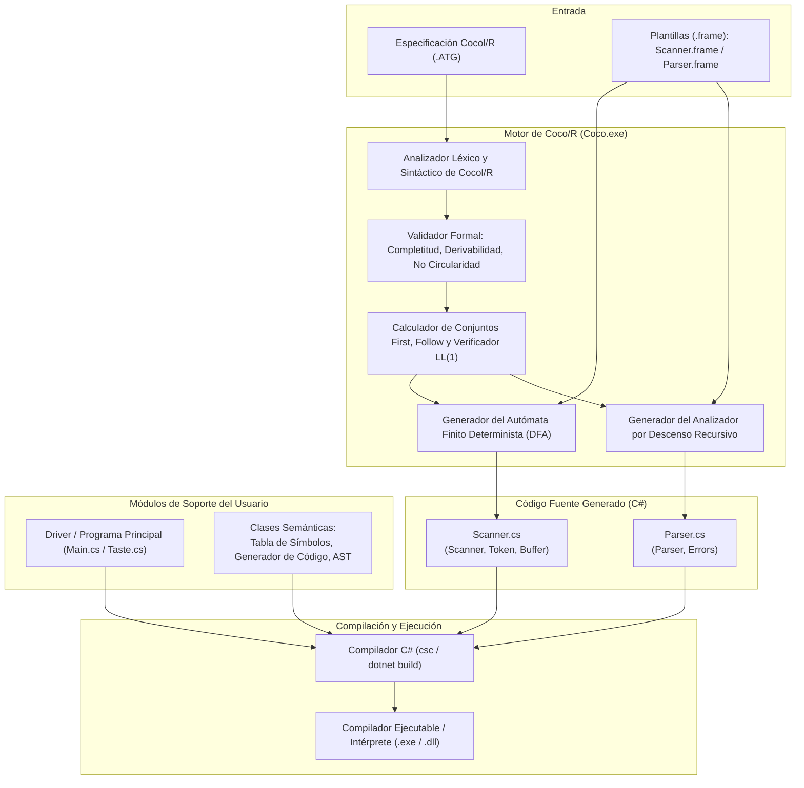
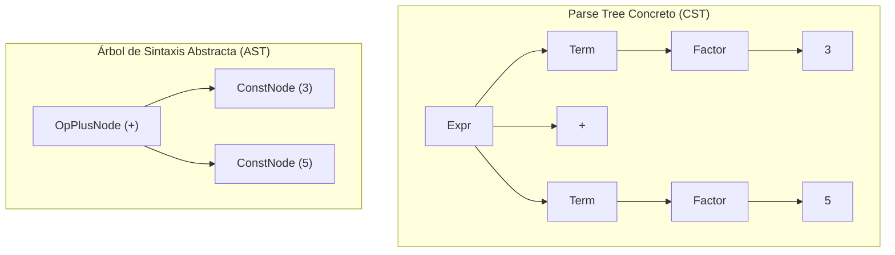
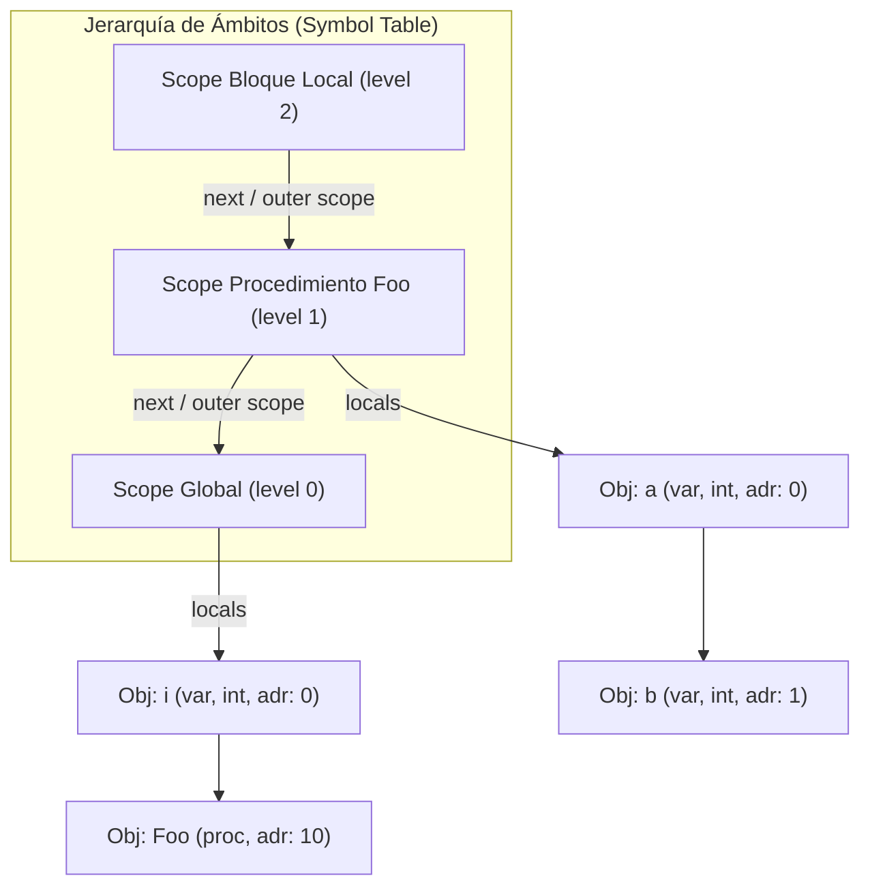

# Investigación Bibliográfica sobre el Generador de Compiladores Coco/R

**Trabajo Final – Compiladores 2026**  
**Autores:** Albornoz Joaquín, Díaz Guadalupe, Gallardo Mateo, Reinoso Abel  
**Fecha:** Octubre de 2026  

---

## 1.1 Introducción a Coco/R

### 1.1.1 Historia y Desarrollo

El generador de compiladores **Coco/R** (*Compiler Compiler / Recursive descent*) fue concebido originalmente a fines de la década de 1980 por **Hanspeter Mössenböck** en el *Institut für Computersysteme* de la Escuela Politécnica Federal de Zúrich (ETH Zürich), bajo la influencia directa del grupo de investigación liderado por **Niklaus Wirth** (creador de Pascal, Modula-2 y Oberon). La motivación primordial de Mössenböck fue desarrollar una herramienta pedagógica y a la vez industrialmente rigurosa que combinara la expresividad de las **gramáticas atribuidas** (*attributed grammars*) con la simplicidad, velocidad y legibilidad del **análisis sintáctico por descenso recursivo** (*recursive descent parsing*).

A diferencia de los generadores contemporáneos predominantes en el ecosistema UNIX —tales como **Lex/Yacc** o **Flex/Bison**, basados en autómatas ascendentes LALR(1)—, Coco/R demostró que una herramienta basada en gramáticas $LL(1)$ enriquecidas con atributos semánticos produce analizadores sintácticos notablemente más fáciles de depurar, pues el código generado se traduce directamente en un conjunto de métodos o procedimientos análogos a los que escribiría a mano un ingeniero de compiladores experimentado.

Posteriormente, con el traslado de Mössenböck a la **Johannes Kepler University Linz (JKU Linz)** en Austria y la creación del *Institut für Systemsoftware (SSW)*, el proyecto continuó su evolución. Una contribución de enorme trascendencia fue la realizada por el profesor **Pat Terry** (Rhodes University, Sudáfrica), quien adaptó y popularizó Coco/R en el ámbito académico internacional a través de sus influyentes libros de texto (*Compilers and Compiler Generators: An Introduction Using C++* en 1997, y *Compiling with C# and Java* en 2004). Terry y el equipo de Linz colaboraron intensamente en el porting de Coco/R a múltiples lenguajes modernos.

A lo largo de las décadas, Coco/R ha sido adaptado oficialmente a numerosos lenguajes de destino:
* **Modula-2 y Oberon:** Versiones fundacionales desarrolladas en ETH Zürich.
* **C y C++:** Mantenidas y extendidas por Pat Terry, Markus Löberbauer y Csaba Balazs.
* **Java:** Versión mantenida por el SSW de Linz, con soporte para plugins de Eclipse e IntelliJ IDEA.
* **C# (.NET):** Adaptada inicialmente con el advenimiento de la plataforma .NET por Pat Terry, Markus Löberbauer y Hanspeter Mössenböck, convirtiéndose en una de las implementaciones más utilizadas debido a la perfecta integración de delegados, paso de parámetros por referencia (`out`/`ref`) y soporte nativo de tipos fuertemente tipados.
* **Otros dialectos y ports:** F# (Alexandre Pereira), VB.NET (Adrian Devries), Delphi (Martin C. Harvey, Serge Voloshenyuk, Mike Reith), Python (*CocoPy*, Ron Longo), Swift (Michael Griebling) y Ada.

El lenguaje de entrada utilizado por la herramienta se denomina formalmente **Cocol/R** (*Compiler Compiler Language / R*), un lenguaje de dominio específico (DSL) conciso que unifica en un único archivo con extensión `.ATG` (*Attributed Grammar*) la especificación léxica, la sintáctica y las acciones semánticas.

---

### 1.1.2 Arquitectura Interna: De la Gramática a la Generación de Código

La arquitectura interna de Coco/R opera como un pipeline sistemático de traducción que transforma una especificación declarativa en un compilador funcional de una o múltiples pasadas. La siguiente figura ilustra el flujo de datos y la arquitectura de componentes de Coco/R:



El pipeline interno de Coco/R consta de las siguientes etapas:

1. **Lectura y Parseo de la Especificación Cocol/R:** Coco/R utiliza internamente su propio escáner y analizador sintáctico para procesar el archivo `.ATG`. Durante esta fase extrae las secciones de encabezado, `CHARACTERS`, `TOKENS`, `PRAGMAS`, `COMMENTS`, `IGNORE` y `PRODUCTIONS`.
2. **Validación Formal de la Gramática:** Antes de emitir cualquier código, Coco/R ejecuta pruebas exhaustivas de sanidad formal sobre la gramática:
   * *Completitud:* Verifica que todo símbolo no terminal posea al menos una producción.
   * *No redundancia:* Comprueba que no existan símbolos no terminales inalcanzables desde el axioma inicial.
   * *Derivabilidad:* Asegura que todos los símbolos no terminales puedan derivar en secuencias finitas de terminales.
   * *No circularidad:* Detecta ciclos gramaticales (como $A \Rightarrow^+ A$).
   * *No ambigüedad léxica:* Verifica que dos clases de tokens no posean definiciones idénticas indistinguibles por el escáner.
3. **Cálculo de Conjuntos Directores y Detección de Conflictos LL(1):** Calcula los conjuntos $First$ y $Follow$ de cada símbolo y expresión regular EBNF. Identifica intersecciones no vacías en alternativas explícitas o implícitas (estructuras opcionales o iterativas) y reporta advertencias $LL(1)$.
4. **Construcción del Autómata Finito Determinista (DFA):** Toma las expresiones regulares de la sección `TOKENS`, las convierte en grafos no deterministas y aplica el algoritmo de construcción de subconjuntos para derivar un autómata finito determinista mínimo que reconozca los lexemas en tiempo lineal.
5. **Generación basada en Plantillas (*Frame Files*):** Coco/R no genera el código desde cero en memoria dura, sino que utiliza archivos de plantilla: `Scanner.frame` y `Parser.frame` (y opcionalmente `Copyright.frame`). Estas plantillas contienen la infraestructura invariable (manejo de buffers, gestión de streams, estructuras de tokens, tablas de palabras reservadas, manejo de excepciones y sincronización de errores). Coco/R reemplaza marcas de posición (*placeholders*) especiales en los frames con el código específico derivado de la gramática (estados del autómata, métodos de parsing, acciones semánticas y resolutores de conflictos).

---

### 1.1.3 Instalación y Configuración

#### Requisitos y Estructura de Archivos
Para trabajar con la versión C# de Coco/R se requieren únicamente tres componentes fundamentales:
1. `Coco.exe`: El binario ejecutable de la herramienta (compilado para .NET / CLR).
2. `Scanner.frame`: La plantilla del analizador léxico en C#.
3. `Parser.frame`: La plantilla del analizador sintáctico en C#.

Opcionalmente, puede suministrarse un archivo `Copyright.frame`, cuyo contenido se insertará automáticamente al principio de los archivos generados.

#### Parámetros de Invocación en Línea de Comandos
La sintaxis de ejecución estándar en consola o PowerShell es la siguiente:
```shell
Coco.exe <ArchivoGramatica.ATG> [Opciones]
```

Las opciones admitidas por la herramienta son:
* `-namespace <Nombre>`: Especifica el espacio de nombres (*namespace*) de C# al que pertenecerán las clases generadas (`Scanner`, `Parser`, `Token`, `Buffer`, `Errors`). Si no se define, las clases se ubican en el espacio de nombres global.
* `-frames <Directorio>`: Indica la ruta al directorio donde se encuentran los archivos `Scanner.frame` y `Parser.frame`. Por defecto, Coco/R los busca en la misma carpeta donde reside el archivo `.ATG`.
* `-o <Directorio>`: Especifica la carpeta de destino donde se escribirán los archivos generados `Scanner.cs` y `Parser.cs`. Si se omite, se depositan en el directorio del archivo `.ATG`.
* `-trace <Cadena>`: Activa volcados de depuración interna (*trace switches*) hacia un archivo llamado `trace.txt`. Los modificadores disponibles incluyen:
  * `A`: Imprime los estados y transiciones del autómata finito del escáner (DFA).
  * `F`: Imprime los conjuntos $First$ y $Follow$ de todos los no terminales.
  * `G`: Vuelca el grafo sintáctico interno de las producciones.
  * `I`: Rastrea el cálculo paso a paso de los conjuntos $First$.
  * `J`: Lista los conjuntos $ANY$ y $SYNC$ empleados en la recuperación de errores.
  * `P`: Imprime estadísticas globales de ejecución (número de estados, tokens, no terminales, tiempos).
  * `S`: Vuelca la tabla de símbolos interna y la lista de literales declarados.
  * `X`: Imprime una tabla de referencias cruzadas de todos los símbolos terminales y no terminales.

#### Directivas Embebidas en la Gramática
Estas opciones también pueden definirse directamente en el archivo `.ATG` mediante directivas con prefijo `$`:
```csharp
$namespace=MiLenguaje.Compilador
$checkEOF=true
$AFX
```
La directiva `$checkEOF=true` (activa por defecto) le indica al parser que debe verificar que se haya alcanzado el fin de archivo (`EOF`) tras procesar el símbolo inicial de la gramática.

---

### 1.1.4 Creación de un Analizador Léxico Simple

A continuación se presenta un ejemplo mínimo pero completo de especificación Cocol/R enfocado en la fase léxica para procesar expresiones aritméticas simples con variables y comentarios:

```csharp
COMPILER CalculadoraSimple

/*--------------------------------------------------------------------------*/
CHARACTERS
  letra   = "ABCDEFGHIJKLMNOPQRSTUVWXYZabcdefghijklmnopqrstuvwxyz_".
  digito  = "0123456789".
  cr      = '\r'.
  lf      = '\n'.
  tab     = '\t'.

/*--------------------------------------------------------------------------*/
TOKENS
  ident   = letra {letra | digito}.
  numero  = digito {digito} ['.' digito {digito}].
  asignar = ":=".

/*--------------------------------------------------------------------------*/
COMMENTS FROM "/*" TO "*/" NESTED
COMMENTS FROM "//" TO lf

/*--------------------------------------------------------------------------*/
IGNORE cr + lf + tab + ' '

/*--------------------------------------------------------------------------*/
PRODUCTIONS
  CalculadoraSimple = { ident asignar numero ';' }.

END CalculadoraSimple.
```

**Análisis de las secciones léxicas:**
* `CHARACTERS`: Define conjuntos discretos de caracteres Unicode. Los operadores de conjunto permitidos son la unión (`+`) y la diferencia (`-`). Por ejemplo, `letra` define el conjunto de caracteres alfabéticos ASCII y el guion bajo.
* `TOKENS`: Define las familias o clases léxicas mediante expresiones regulares. La regla para `numero` admite enteros o números con punto flotante opcional.
* `COMMENTS`: Define delimitadores de comentarios. La cláusula `NESTED` permite anidamiento arbitrario de bloques `/* ... /* ... */ ... */`, una capacidad que excede a las expresiones regulares regulares puras y que Coco/R resuelve mediante contadores en el escáner.
* `IGNORE`: Define el conjunto de caracteres en blanco (*whitespace*) que el escáner descartará de forma transparente entre tokens sucesivos.

---

### 1.1.5 Generación y Compilación del Analizador

El proceso de construcción y compilación dentro de un entorno moderno de desarrollo en C# (.NET) involucra los siguientes pasos:

1. **Ejecución del Generador:**
   ```powershell
   tools\coco\Coco.exe CalculadoraSimple.ATG -frames tools\coco -namespace Calculadora
   ```
   Esta instrucción genera `Scanner.cs` y `Parser.cs` en el directorio de trabajo.

2. **Estructura del Proyecto .NET:**
   Se crea o dispone un proyecto de consola o biblioteca de clases (`.csproj`). Los archivos generados se compilan junto con el punto de entrada de la aplicación (`Program.cs`):

   ```xml
   <Project Sdk="Microsoft.NET.Sdk">
     <PropertyGroup>
       <OutputType>Exe</OutputType>
       <TargetFramework>net8.0</TargetFramework>
       <ImplicitUsings>enable</ImplicitUsings>
       <Nullable>disable</Nullable>
     </PropertyGroup>
   </Project>
   ```

3. **Automatización mediante MSBuild:**
   Es una excelente práctica configurar una tarea previa a la compilación (`PreBuildEvent`) en el archivo `.csproj` para que la regeneración del escáner y parser sea automática cada vez que se modifique el archivo `.ATG`:
   ```xml
   <Target Name="GenerateParser" BeforeTargets="PreBuildEvent" Inputs="CalculadoraSimple.ATG" Outputs="Parser.cs;Scanner.cs">
     <Exec Command="&quot;$(ProjectDir)tools\coco\Coco.exe&quot; &quot;$(ProjectDir)CalculadoraSimple.ATG&quot; -frames &quot;$(ProjectDir)tools\coco&quot; -namespace Calculadora" />
   </Target>
   ```

4. **Compilación y Enlace:**
   ```powershell
   dotnet build
   ```
   El compilador Roslyn de C# compila de manera transparente `Scanner.cs`, `Parser.cs` y el código del usuario, produciendo el binario final.

---

### 1.1.6 Análisis de la Salida Generada

Coco/R traduce la gramática en dos archivos primarios de código fuente C#:

#### 1. Archivo `Scanner.cs`
Contiene la implementación del reconocedor léxico y tres clases vitales:
* `Buffer`: Abstrae la fuente de entrada (archivos en disco, memoria o flujos de red `Stream`). Permite lectura secuencial mediante `Read()`, lectura anticipada de caracteres sin consumirlos mediante `Peek()`, modificación de la posición de lectura con la propiedad `Pos`, y extracción de subcadenas arbitrarias del texto fuente con `GetString(beg, end)`.
* `Token`: Estructura que representa la unidad léxica reconocida. Sus atributos públicos fundamentales son:
  * `kind`: Identificador numérico entero que representa la categoría sintáctica del token (ej. 1 para `ident`, 2 para `numero`). El valor `0` está reservado unívocamente para el token de fin de archivo (`_EOF`).
  * `pos`: Desplazamiento en bytes del token desde el inicio del archivo fuente.
  * `charPos`: Posición en caracteres.
  * `col`: Número de columna donde inicia el token (base 1).
  * `line`: Número de línea donde inicia el token (base 1).
  * `val`: Cadena de texto (*lexeme*) exacta leída de la entrada.
* `Scanner`: Implementa el autómata finito determinista. Su método neurálgico es `Scan()`, que lee caracteres del `Buffer`, transita por los estados del DFA y retorna el siguiente objeto `Token`. Asimismo, ofrece los métodos `Peek()` y `ResetPeek()`, indispensables para el análisis predictivo de múltiples símbolos lookahead.

#### 2. Archivo `Parser.cs`
Contiene el motor de análisis sintáctico descendente y el reporte de errores:
* `Parser`: Clase central que aloja las variables de estado:
  * `t`: Almacena el token más recientemente reconocido y validado.
  * `la`: Almacena el token de preanálisis (*lookahead token*) actualmente bajo inspección.
  * `scanner`: Referencia al escáner asociado.
  * `errors`: Referencia al objeto manejador de errores.
  * `Parse()`: Método público de inicio que carga el primer token en `la` e invoca el método correspondiente al axioma inicial de la gramática.
  * `Get()`: Consume el token actual, asigna `t = la` y obtiene el nuevo `la = scanner.Scan()`.
  * `Expect(int n)`: Valida si `la.kind == n`. Si coincide, avanza llamando a `Get()`; si no coincide, invoca inmediatamente al manejador de errores de sintaxis `SynErr(n)`.
* `Errors`: Encargada de recolectar, formatear y emitir advertencias y errores:
  * `count`: Contador acumulado de errores léxicos, sintácticos y semánticos.
  * `SynErr(int line, int col, int n)`: Emite un mensaje de error sintáctico con formato `{0},{1}: {2}` (línea, columna, mensaje descriptivo predefinido o derivado del conjunto de símbolos esperados).
  * `SemErr(int line, int col, string msg)`: Emite errores semánticos personalizados originados en las acciones semánticas del desarrollador.
  * `Warning(int line, int col, string msg)`: Emite advertencias no fatales (no incrementan `count`).
  * **Mecanismo de Supresión de Errores en Cascada:** Para evitar inundar la salida con diagnósticos espurios causados por un único error original, el parser implementa una ventana de estabilización: tras un fallo, solo se emite un nuevo error sintáctico si el analizador logra reconocer exitosamente al menos **dos tokens consecutivos** en la corriente de entrada.

---

## 1.2 Conceptos Fundamentales Relacionados con Coco/R

### 1.2.1 Expresiones Regulares y Tokens

Un **token** o componente léxico es un par abstracto compuesto por un nombre de categoría léxica y un valor de atributo opcional. El **lexema** es la secuencia concreta de caracteres en el código fuente que encaja con el patrón descripto por una **expresión regular**.

En la teoría de lenguajes formales, sobre un alfabeto finito $\Sigma$, una expresión regular denota un lenguaje regular mediante tres operaciones fundamentales:
1. **Concatenación:** $L(r_1 r_2) = L(r_1) L(r_2)$
2. **Unión (Alternativa):** $L(r_1 \mid r_2) = L(r_1) \cup L(r_2)$
3. **Clausura de Kleene (Repetición cero o más veces):** $L(r^*) = \bigcup_{i=0}^{\infty} L(r)^i$

En Cocol/R, las expresiones regulares de la sección `TOKENS` se expresan mediante una variante formal de EBNF:
* La concatenación se expresa por yuxtaposición: `a b`.
* La alternativa se denota con una barra vertical: `a | b`.
* La repetición (cero o más veces) se encierra entre llaves: `{ a }`.
* La opcionalidad (cero o una vez) se encierra entre corchetes: `[ a ]`.
* El agrupamiento explícito se denota con paréntesis: `( a )`.

#### Distinción entre Literales y Clases de Tokens
Coco/R distingue conceptualmente dos formas de terminales:
* **Clases de Tokens:** Poseen una estructura variable e infinita de lexemas posibles (por ejemplo, identificadores o constantes numéricas) y se definen obligatoriamente en la sección `TOKENS`.
* **Tokens Literales:** Poseen una representación textual única y fija (palabras clave como `"if"`, `"while"`, o símbolos de puntuación como `";"`, `"+"`, `":="`). En Coco/R no es obligatorio declararlos en la sección `TOKENS`; el generador los detecta automáticamente al aparecer entre comillas en las producciones sintácticas y les asigna códigos numéricos internos.

#### Tokens Dependientes de Contexto (`CONTEXT`)
Existen escenarios en lenguajes de programación donde un lexema no puede clasificarse unívocamente sin observar los caracteres subsiguientes, pero sin que dichos caracteres formen parte del token en sí. Un caso clásico es la ambigüedad entre números de punto flotante y rangos de enteros:
* `1.23` es un número decimal.
* `1..5` es un rango entero donde el primer token es `1` y el segundo es `..`.

Coco/R resuelve esta situación mediante la cláusula `CONTEXT`:
```csharp
TOKENS
  number = digit {digit}
         | digit {digit} CONTEXT ("..").
  float  = digit {digit} '.' {digit}.
```
Cuando el escáner lee `1.`, inspecciona el siguiente carácter. Si detecta otro `.`, activa la regla dependiente de contexto: empuja hacia atrás en el buffer la secuencia `..` y retorna con éxito el token `number` con valor `1`.

---

### 1.2.2 Autómatas Finitos y cómo Coco/R los Implementa

Un **Autómata Finito Determinista (DFA)** es formalmente una 5-tupla:
$$M = (Q, \Sigma, \delta, q_0, F)$$
donde:
* $Q$ es un conjunto finito de estados.
* $\Sigma$ es el alfabeto de entrada.
* $\delta: Q \times \Sigma \rightarrow Q$ es la función de transición de estados determinista.
* $q_0 \in Q$ es el estado inicial.
* $F \subseteq Q$ es el conjunto de estados finales o de aceptación.

#### Conversión Interna: De EBNF a DFA
Internamente, Coco/R toma las especificaciones de tokens en EBNF y construye grafos de transición. Si existen alternativas que comparten prefijos (por ejemplo, `0` y `0x1A`), Coco/R ejecuta el **algoritmo de construcción de subconjuntos** (*subset construction*) para garantizar el determinismo absoluto: para cada par de (estado, carácter de entrada), existe a lo sumo un estado destino.

#### Implementación del DFA en C#
En `Scanner.cs`, Coco/R implementa el DFA mediante un bucle de estados altamente optimizado dentro del método `Scan()`. La estructura general se asemeja al siguiente patrón en C#:

```csharp
// Fragmento ilustrativo del patrón de DFA generado en Scanner.cs
int state = start[ch]; // Determinación de estado inicial según carácter
while (true) {
    ch = buffer.Read();
    switch (state) {
        case 1:
            if (ch >= '0' && ch <= '9') { state = 1; }
            else if (ch == '.') { state = 2; }
            else { return AcceptToken(TokenKind.Number); }
            break;
        case 2:
            if (ch >= '0' && ch <= '9') { state = 3; }
            else { Error(); }
            break;
        case 3:
            if (ch >= '0' && ch <= '9') { state = 3; }
            else { return AcceptToken(TokenKind.Float); }
            break;
    }
}
```

Esta implementación garantiza que el escáner opere en **tiempo lineal estricto $\mathcal{O}(N)$**, donde $N$ es la longitud en caracteres del texto fuente, procesando cada carácter una sola vez sin recurrir a mecanismos costosos de *backtracking*.

---

### 1.2.3 Gramáticas Libres de Contexto y EBNF en Coco/R

Una **Gramática Libre de Contexto (GLC)** se define formalmente como:
$$G = (V_N, V_T, P, S)$$
donde $V_N$ es el conjunto de símbolos no terminales, $V_T$ es el alfabeto de símbolos terminales (tokens), $P$ es el conjunto finito de reglas de producción de la forma $A \rightarrow \alpha$ (con $A \in V_N$ y $\alpha \in (V_N \cup V_T)^*$), y $S \in V_N$ es el símbolo inicial o axioma.

#### Notación EBNF de Wirth / ISO
En la formulación canónica de Backus-Naur (BNF), las estructuras repetitivas y opcionales exigen la proliferación de reglas auxiliares y recursión. Coco/R adopta la notación **EBNF** propuesta por Niklaus Wirth (1977), la cual aporta operadores de alto nivel:

| Construcción EBNF en Coco/R | Significado Teórico | Equivalente en BNF Canónico |
| :--- | :--- | :--- |
| `A = α β.` | Secuencia / Concatenación | $A \rightarrow \alpha \beta$ |
| `A = α \| β.` | Alternativa disyunta | $A \rightarrow \alpha \quad\mid\quad A \rightarrow \beta$ |
| `A = [ α ].` | Opcionalidad (0 o 1 vez) | $A \rightarrow \alpha \quad\mid\quad \varepsilon$ |
| `A = { α }.` | Iteración (0 o más veces) | $A \rightarrow A' \quad A' \rightarrow \alpha A' \;\mid\; \varepsilon$ |
| `A = ( α \| β ) γ.` | Agrupamiento con factor común | $A \rightarrow A' \gamma \quad A' \rightarrow \alpha \;\mid\; \beta$ |

Esta notación concisa no solo hace que la gramática sea mucho más compacta y legible para el diseñador, sino que mapea de forma directa y elegante hacia las estructuras de control procedurales de los lenguajes imperativos modernos (`if-else`, `while`).

---

### 1.2.4 Árboles Sintácticos: Parse Tree vs. AST y la Filosofía de Coco/R

En el diseño de compiladores es fundamental distinguir dos tipos de estructuras arbóreas:
1. **Árbol de Análisis Sintáctico Concreto (*Parse Tree* o *CST*):** Refleja la totalidad de los pasos de derivación formal de la gramática. Cada nodo interior representa un símbolo no terminal y cada hoja un token terminal (incluyendo signos de puntuación como paréntesis o comas). Es computacionalmente redundante y rara vez se almacena en memoria de forma explícita.
2. **Árbol de Sintaxis Abstracta (*Abstract Syntax Tree* o *AST*):** Es una representación jerárquica condensada que retiene únicamente la estructura lógica y los operandos y operadores significativos del programa, suprimiendo detalles puramente sintácticos (como palabras clave de agrupamiento o separadores).

#### La Filosofía de Coco/R
A diferencia de herramientas como ANTLR (que instancian de manera automática un AST genérico para todo el programa), **Coco/R fue concebido bajo el paradigma de compilación en una sola pasada (*one-pass compiler*)**. En este modelo, las acciones semánticas y la generación de código se ejecutan directamente en vuelo a medida que el parser reconoce las producciones sintácticas.

Sin embargo, para lenguajes complejos que requieren múltiples pasadas de optimización o chequeo de tipos hacia adelante, Coco/R permite construir un AST explícito de forma sumamente sencilla y personalizada: basta con declarar clases nodales en C# e instanciarlas dentro de las acciones semánticas asociadas a las producciones.



---

### 1.2.5 Descenso Recursivo Generado Automáticamente

El análisis sintáctico por **descenso recursivo** es una técnica descendente (*top-down*) en la cual cada símbolo no terminal de la gramática libre de contexto se traduce en un método o procedimiento ejecutable en el código destino. La ejecución comienza con una llamada al método que implementa el axioma inicial y se desenvuelve invocando métodos subordinados a medida que avanza por la cadena de tokens.

Coco/R traduce mecánicamente los operadores de EBNF a código estructurado en C# aplicando el siguiente mapeo riguroso:

| Elemento EBNF en `.ATG` | Código C# Generado en `Parser.cs` |
| :--- | :--- |
| **Símbolo terminal `a`** | `Expect(_a);` |
| **Símbolo no terminal `A`** | `A();` |
| **Alternativa `α \| β`** | `if (la.kind == ...) { ... } else if (la.kind == ...) { ... } else SynErr(...);` |
| **Opcionalidad `[ α ]`** | `if (la.kind == ...) { ... }` |
| **Iteración `{ α }`** | `while (la.kind == ...) { ... }` |
| **Acción semántica `(. ... .)`** | Se copia textualmente el bloque C# en el método. |
| **Atributo de entrada `<int x>`** | Parámetro formal por valor: `void A(int x)` |
| **Atributo de salida `<out int y>`**| Parámetro formal por referencia: `void A(out int y)` |

#### El Símbolo Especial `ANY`
Coco/R provee el símbolo especial `ANY`, que denota cualquier token terminal excepto aquellos que constituyen alternativas explícitas o símbolos sucesores en la estructura gramatical circundante. Es sumamente potente para consumir texto libre o secuencias de escape:
```csharp
Attributes<out int len> = 
  '<' (. int inicio = t.pos + 1; .)
  { ANY }
  '>' (. len = t.pos - inicio; .) .
```
En este ejemplo, `{ ANY }` consume cualquier token hasta encontrar el delimitador `'>'`, permitiendo un parseo eficiente sin definir reglas léxicas intermedias artificiales.

---

### 1.2.6 Conflictos LL(1) y su Resolución en Coco/R

Para que una gramática sea analizable de forma unívoca por descenso recursivo puro con un solo token de preanálisis, debe pertenecer a la clase gramatical **$LL(1)$** (*Left-to-right parse, Leftmost derivation, 1 lookahead token*).

#### Condiciones Formales LL(1)
Sean $\alpha$ y $\beta$ expresiones en EBNF:
1. **Alternativas disyuntas ($A = \alpha \mid \beta$):**
   $$First(\alpha) \cap First(\beta) = \emptyset$$
2. **Estructuras opcionales ($A = [\alpha]\, \beta$):**
   $$First(\alpha) \cap First(\beta) = \emptyset$$
   Si $\beta$ es vacío ($A = [\alpha]$), se requiere:
   $$First(\alpha) \cap Follow(A) = \emptyset$$
3. **Estructuras iterativas ($A = \{\alpha\}\, \beta$):**
   $$First(\alpha) \cap First(\beta) = \emptyset$$
   Si $\beta$ es vacío ($A = \{\alpha\}$), se requiere:
   $$First(\alpha) \cap Follow(A) = \emptyset$$
4. **No nulabilidad en estructuras repetitivas:** El contenido interno de $[\alpha]$ o $\{\alpha\}$ no puede derivar en la cadena vacía $\varepsilon$ (*deletable*).

#### Detección de Conflictos y Comportamiento por Defecto
Cuando una gramática viola alguna de estas condiciones, Coco/R emite una advertencia formal durante la fase de compilación:
* `LL1 warning in Statement: ident is start of several alternatives`
* `LL1 warning in QualId: id is start & successor of deletable structure`

A diferencia de otros compiladores que se detienen ante advertencias, Coco/R **genera de todos modos el parser**. Por defecto, resuelve la ambigüedad de manera voraz: ante alternativas en conflicto que comienzan con el mismo token, **siempre selecciona la primera alternativa declarada en la gramática**. Esta regla determinista resuelve elegantemente el célebre conflicto del *dangling else* presente en lenguajes como C, Java o Pascal:
```csharp
Statement = "if" '(' Expr ')' Statement ["else" Statement].
```
Al aparecer una cláusula `"else"`, el parser la asocia de inmediato al `if` anidado más próximo, que es el comportamiento semántico estándar esperado.

#### Técnicas de Resolución de Conflictos

##### 1. Transformación de Gramática: Factorización a Izquierda
Consiste en extraer el prefijo común a las alternativas conflictivas:
```csharp
// Con conflicto LL(1):
Statement = ident '=' Expr ';' | ident '(' Params ')' ';'.

// Factorizado (cumple LL(1)):
Statement = ident ( '=' Expr ';' | '(' Params ')' ';' ).
```

##### 2. Transformación de Gramática: Eliminación de Recursión a Izquierda
La recursión izquierda directa ($A = A\, \alpha \mid \beta$) viola fatalmente la propiedad $LL(1)$ porque $First(A\,\alpha)$ siempre colisiona con $First(\beta)$. En EBNF se elimina de inmediato sustituyéndola por una iteración:
```csharp
// Recursión a izquierda conflictiva:
Expr = Expr '+' Term | Term.

// Equivalente EBNF iterativo:
Expr = Term { '+' Term }.
```

##### 3. Resolutores Sintácticos con Lookahead Multi-Símbolo (`IF(...)`)
Existen casos donde la factorización degrada intolerablemente la legibilidad de la gramática o es estructuralmente inviable (por ejemplo, en C# al distinguir entre una conversión de tipo `(int)x` y una expresión entre paréntesis `(x + 1)`). Coco/R permite resolver estos conflictos elevando la clase gramatical a **$LL(k)$** mediante la cláusula `IF(...)`:

```csharp
Factor = IF(IsCast()) '(' ident ')' Factor
       | '(' Expr ')'
       | ident
       | number.
```

El método `IsCast()` se implementa en C# consultando los tokens futuros mediante el escáner sin consumirlos:
```csharp
bool IsCast() {
    Token next = scanner.Peek();
    // Si encontramos '(' seguido de un identificador que representa un tipo:
    if (la.kind == _lpar && next.kind == _ident) {
        Obj obj = symTab.Find(next.val);
        return obj != null && obj.kind == ObjKind.Type;
    }
    return false;
}
```

##### 4. Resolutores Semánticos
El predicado booleano dentro de `IF(...)` puede invocar cualquier lógica arbitraria de C#, incluyendo consultas a la tabla de símbolos o banderas de contexto léxico.

**Regla de Ubicación de los Resolutores:** El resolutor debe colocarse obligatoriamente **al inicio de la primera alternativa en conflicto**. Colocarlo en la segunda alternativa o en una posición donde no exista conflicto es detectado y reportado como un error de especificación por Coco/R.

---

### 1.2.7 Tabla de Símbolos: Estructura y Operaciones

La **Tabla de Símbolos** es la estructura de datos medular encargada del análisis semántico contextual. Mantiene el registro de todos los identificadores declarados (variables, constantes, funciones, procedimientos, tipos), sus atributos estáticos y su visibilidad de acuerdo con las reglas de **alcance léxico (*scoping*)** del lenguaje.

#### Estructura Interna: Nodos y Ámbitos Anidados
En implementaciones típicas de Coco/R (como en el compilador de referencia TASTE), la tabla se modela mediante:
* Una clase `Obj` que encapsula la información de cada identificador:
  * `name`: Nombre del símbolo (identificador).
  * `kind`: Categoría (variable, constante, procedimiento, tipo).
  * `type`: Tipo de dato asociado (entero, booleano, indefinido).
  * `adr`: Dirección de memoria, desplazamiento relativo en el marco de pila (*stack frame offset*) o dirección de inicio de código.
  * `level`: Nivel de anidamiento estático (0 para variables globales, 1 para locales, etc.).
  * `locals`: Lista enlazada de símbolos declarados localmente dentro de este ámbito.
  * `next`: Enlace al siguiente símbolo declarado en el mismo ámbito.
* Una clase `SymbolTable` que gestiona la jerarquía de ámbitos mediante una pila de scopes (`topScope`):



#### Operaciones Canónicas de la Tabla de Símbolos
1. **`OpenScope()`:** Se invoca al ingresar a una nueva frontera de visibilidad (declaración de función, procedimiento o bloque delimitado). Crea un nuevo objeto `Scope`, asigna el puntero exterior al ámbito actual, incrementa el nivel de anidamiento (`curLevel++`) y reinicia el contador de direcciones relativas para variables locales.
2. **`CloseScope()`:** Se invoca al abandonar el bloque sintáctico. Desvincula el ámbito actual (`topScope = topScope.next`), decrementa `curLevel--` y oculta los identificadores locales para que dejen de ser visibles.
3. **`NewObj(name, kind, type)` (o `Insert`):** Inserta un nuevo símbolo en el ámbito actual (`topScope.locals`). Recorre la lista de símbolos del ámbito vigente para comprobar que no exista una colisión de nombres. Si el identificador ya fue declarado en el mismo nivel, emite un error semántico (`"name declared twice"`). Si es una variable, le asigna la dirección relativa actual y la incrementa.
4. **`Find(name)` (o `Lookup`):** Busca un identificador de adentro hacia afuera: inicia la búsqueda en `topScope.locals`; si no lo encuentra, sube a través de la cadena de ámbitos exteriores (`scope = scope.next`) hasta alcanzar el nivel global. Si el identificador no existe en ningún ámbito accesible, reporta un error semántico (`"identifier is undeclared"`) y retorna un objeto centinela especial (`undefObj`) para permitir que la compilación continúe sin lanzar excepciones nulas en cascada.

---

### 1.2.8 Generación de Código: Código Intermedio, Código Máquina y Coco/R

El objetivo final de un compilador es traducir el árbol sintáctico o la secuencia de producciones en una secuencia de instrucciones ejecutables.

#### Categorías de Código Generado
* **Código Máquina Nativo:** Instrucciones binarias específicas de una arquitectura física (x86-64, ARM64, RISC-V). Requiere gestión compleja de registros de hardware, convención de llamadas del sistema operativo y formatos ejecutables (PE, ELF).
* **Código Intermedio (*Intermediate Representation* - IR):** Representación abstracta independiente de la máquina física. Puede materializarse como:
  * *Grafos o árboles decorados.*
  * *Código de tres direcciones (3AC) o cuádruplos:* `(op, arg1, arg2, res)`.
  * *Bytecode para máquinas virtuales de pila (*Stack Machine Code*):* Instrucciones compactas que operan sobre operandos implícitos en una pila de evaluación (ej. JVM de Java, CIL de .NET, o la máquina de TASTE).

#### Integración con Coco/R y Generación en una Sola Pasada
Coco/R destaca particularmente en la emisión directa de código intermedio de pila. Al procesar gramáticas L-atribuidas, la emisión de instrucciones se realiza de forma natural conforme se reconocen las subexpresiones:

```csharp
SimExpr<out int type> = Term<out type> 
  { '+' Term<out type1> (. gen.Emit(Op.ADD); .) 
  }.
```
Para evaluar `a + b`, el parser primero invoca el reconocimiento de `a` (emitiendo `LOAD a`), luego el de `b` (emitiendo `LOAD b`), y finalmente la acción semántica emite `ADD`, dejando la suma en la cima de la pila.

#### Manejo de Saltos Hacia Adelante y Backpatching (`Patch`)
Un desafío clásico en compiladores de una sola pasada ocurre con las estructuras de control condicionales (`if-else`) e iterativas (`while`): cuando el compilador emite una instrucción de salto condicional hacia adelante (`FJMP`), aún no conoce la dirección de memoria exacta a la que debe saltar, pues el cuerpo de la sentencia aún no ha sido procesado ni generado.

Coco/R y sus generadores auxiliares resuelven esto mediante **backpatching**:
1. Se emite la instrucción `FJMP` con una dirección de destino provisoria (por ejemplo, `0`).
2. Se guarda en una variable local del método de parsing la posición en el arreglo de código donde debe inscribirse la dirección definitiva: `adr = gen.pc - 2;`.
3. Se parsea el cuerpo de la sentencia.
4. Al concluir el cuerpo, se conoce el contador de programa actual (`gen.pc`). Se llama a `gen.Patch(adr, gen.pc)`, sobreescribiendo en la memoria de código los dos bytes de destino que habían quedado pendientes.

---

## 1.3 Mejores Prácticas en el Uso de Coco/R

1. **Separación Estricta entre Sintaxis y Semántica:** Se recomienda mantener las acciones semánticas en el archivo `.ATG` tan breves y legibles como sea posible. La lógica compleja (validaciones de tipos, asignación de registros, manipulación de tablas) debe delegarse a métodos auxiliares en clases C# independientes (`SymbolTable.cs`, `CodeGen.cs`, `AST.cs`).
2. **Formato en Dos Columnas:** Por convención de estilo de Mössenböck y Terry, es una buena práctica alinear los símbolos sintácticos a la izquierda del archivo `.ATG` y las acciones semánticas `(. ... .)` a la derecha mediante tabulaciones. Esto permite inspeccionar la estructura de la gramática a simple vista.
3. **Uso Moderado y Estratégico de `SYNC` y `WEAK`:** Introducir puntos de sincronización (`SYNC`) exclusivamente en encabezados de sentencias o secuencias de declaraciones seguras (donde aparecen palabras clave como `void`, `int`, `if`, `while`). Si se colocan demasiados puntos `SYNC`, el parser puede descartar fragmentos válidos de código ante errores menores.
4. **Manejo Seguro de Errores con Nodos Centinela:** Al detectar identificadores no declarados o tipos incompatibles, no se debe interrumpir la ejecución con excepciones no controladas ni retornar referencias nulas. Es fundamental retornar un objeto comodín (como `undefObj` o `Type.Undef`) para que las fases posteriores continúen parseando el resto del archivo y detecten la totalidad de los errores en una única corrida.
5. **Alineación de Tipos y Enums:** Centralizar los identificadores de tipos y operaciones en enumeraciones compartidas (`enum Op`, `enum DataType`), evitando el uso de cadenas de texto mágicas o números dispersos.

---

## 1.4 Casos de Uso Reales de Coco/R

Coco/R no se limita únicamente a la construcción de compiladores completos para lenguajes de propósito general, sino que ha sido adoptado ampliamente en la industria y el ámbito académico para procesar lenguajes estructurados y lenguajes de dominio específico (DSL):

* **Boogie (Microsoft Research):** Boogie es un lenguaje intermedio y entorno de verificación estática de programas desarrollado por Microsoft Research. Utiliza Coco/R para procesar la sintaxis formal de sus modelos de verificación y condiciones de corrección de software.
* **Analizadores Estáticos y Métricas de Código:** Herramientas que calculan métricas de complejidad ciclomática de McCabe, anidamiento de estructuras de control y uso de variables globales/locales en bases de código heredadas.
* **Generadores de Referencias Cruzadas e Indexadores:** Utilidades que analizan programas fuente y extraen tablas de referencias cruzadas indicando en qué archivos, clases y líneas se declara o consulta cada símbolo.
* **Formateadores de Código (*Pretty Printers*):** Herramientas que leen código fuente, ignoran el formateo original y lo reescriben aplicando estándares de indentación y espaciado rigurosos.
* **Front-Ends para Editores Orientados a la Sintaxis:** Utilizado para implementar parseo rápido y liviano en herramientas de desarrollo integrado (IDE), resaltado sintáctico y autocompletado en plugins de Eclipse e IntelliJ.
* **Herramientas de Cobertura y Pruebas de Caja Blanca:** Instrumentadores que analizan el código, insertan contadores y temporizadores en cada rama de decisión y miden la cobertura de ejecución en tiempo de prueba.
* **Lenguajes de Dominio Específico (DSL) e Intérpretes de Scripting:** Ampliamente adoptado en el sector industrial para diseñar lenguajes de configuración de autómatas programables, motores de reglas de negocio, lenguajes de consulta de bases de datos especializadas y analizadores de archivos de registro (*log analyzers*) de alto rendimiento.

---

## 1.5 Referencias Bibliográficas

1. **Mössenböck, Hanspeter.** (1990). *A Generator for Production Quality Compilers*. Proceedings of the 3rd International Workshop on Compiler Compilers (CC'90), Schwerin, LNCS 477, Springer-Verlag, pp. 42–55.
2. **Mössenböck, Hanspeter.** (2011). *The Compiler Generator Coco/R – User Manual*. Institut für Systemsoftware, Johannes Kepler Universität Linz.
3. **Mössenböck, Hanspeter.** (2018). *Compilerbau: Grundlagen, Methoden, Werkzeuge und Anwendungen*. Hanser Verlag. **[VERIFICAR: referencia no confirmada por el supervisor; posible alucinación de la IA, eliminar si no se encuentra]**
4. **Terry, Patrick D.** (1997). *Compilers and Compiler Generators: An Introduction with C++*. International Thomson Computer Press.
5. **Terry, Patrick D.** (2004). *Compiling with C# and Java*. Pearson Education / Addison-Wesley.
6. **Wöß, Albrecht; Löberbauer, Markus; Mössenböck, Hanspeter.** (2003). *LL(1) Conflict Resolution in a Recursive Descent Compiler Generator*. Joint Modular Languages Conference (JMLC'03), Klagenfurt, LNCS 2789, Springer-Verlag, pp. 192–206.
7. **Wirth, Niklaus.** (1977). *What Can We Do about the Unnecessary Diversity of Notation for Syntactic Definitions?* Communications of the ACM, Vol. 20, No. 11, pp. 822–823.
8. **Aho, Alfred V.; Lam, Monica S.; Sethi, Ravi; Ullman, Jeffrey D.** (2006). *Compilers: Principles, Techniques, and Tools* (2nd Edition). Addison-Wesley.
