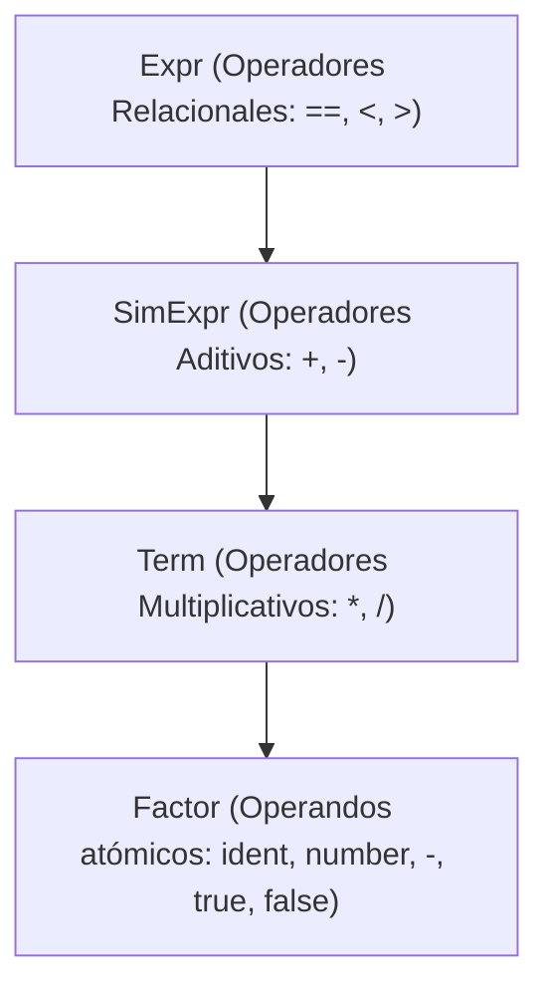
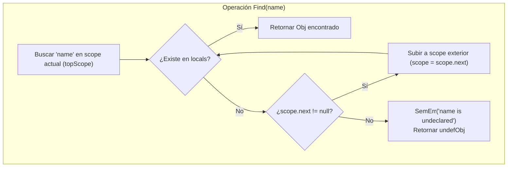
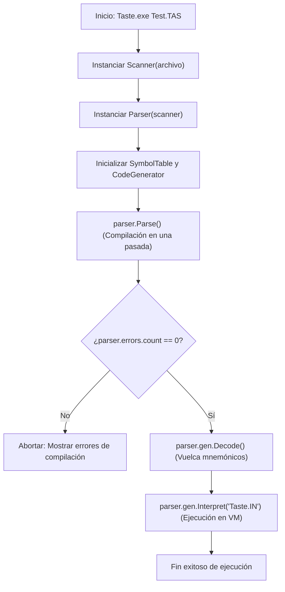

# Guía Técnica Exhaustiva del Proyecto TASTE para la Defensa Oral

**Materia:** Compiladores 2026  
**Autores:** Albornoz Joaquín, Díaz Guadalupe, Gallardo Mateo, Reinoso Abel  
**Fecha de Defensa Oral:** 19 de Octubre de 2026  
**Objetivo:** Proporcionar una comprensión profunda, línea por línea y componente por componente, del compilador e intérprete pedagógico **TASTE** provisto por Hanspeter Mössenböck, para afrontar con solvencia técnica la defensa oral del Trabajo Final.

---

## 1. El Lenguaje Fuente: Taste

**Taste** es un lenguaje imperativo, tipado estáticamente, diseñado con fines puramente didácticos para ilustrar la construcción de un compilador completo en una sola pasada (*one-pass compiler*) utilizando el generador Coco/R en C#.

### Características Sintácticas y Semánticas
* **Estructura del Programa:** Un programa Taste está encapsulado en una unidad léxica `program Ident { ... }` que contiene declaraciones de variables globales y procedimientos.
* **Tipos de Datos Primitivos:** Admite únicamente dos tipos elementales:
  * `int`: Números enteros de 32 bits con signo.
  * `bool`: Valores de verdad (`true` y `false`).
* **Variables:** Declaraciones explícitas de variables globales y locales mediante la palabra clave de tipo seguida por una lista de identificadores separados por comas (ej. `int a, b, c;`).
* **Procedimientos:** Subrutinas sin parámetros formales ni valores de retorno tipados, declaradas con la sintaxis `void Ident() { ... }`. Los procedimientos pueden alojar variables locales y llamadas a otros procedimientos.
* **Punto de Entrada Obligatorio:** Todo programa Taste debe contener obligatoriamente un procedimiento llamado `Main()`, el cual actúa como punto de arranque de la ejecución.
* **Estructuras de Control de Flujo:**
  * Sentencia condicional bifurcada: `if (Condicion) Sentencia [else Sentencia]`.
  * Sentencia iterativa: `while (Condicion) Sentencia`.
  * Sentencias compuestas o bloques: delimitados entre llaves `{ Sentencia1 Sentencia2 ... }`.
* **Instrucciones de Entrada/Salida:**
  * `read Ident;`: Lee un número entero desde el flujo de entrada estándar o archivo y lo asigna a la variable.
  * `write Expresion;`: Evalúa una expresión de tipo entero e imprime su valor numérico en una nueva línea de la consola.
* **Expresiones y Operadores:**
  * Aritméticos: Suma (`+`), Resta (`-`), Multiplicación (`*`), División (`/`), Negación unaria (`-`).
  * Relacionales: Igualdad (`==`), Menor estricto (`<`), Mayor estricto (`>`).

### Programa de Ejemplo de Referencia (`Test.TAS`)
```csharp
// Programa de prueba para el compilador Taste
program Test {
    int i;
    
    void Foo() {
        int a, b, max;
        read a; read b;
        if (a > b) max = a; else max = b;
        write max;
    }

    void SumUp() {
        int sum;
        sum = 0;
        while (i > 0) { 
            sum = sum + i; 
            i = i - 1; 
        }
        write sum;
    }

    void Main() {
        read i;
        while (i > 0) {
            SumUp();
            read i;
        }
    }
}
```

---

## 2. Análisis Sección por Sección de la Gramática `Taste.ATG`

El archivo `Taste.ATG` constituye la especificación formal del compilador en el lenguaje Cocol/R. A continuación se desglosa minuciosamente cada bloque.

### 2.1 Encabezado y Declaraciones Globales (`COMPILER Taste`)
```csharp
COMPILER Taste

    const int // types
      undef = 0, integer = 1, boolean = 2;

    const int // object kinds
      var = 0, proc = 1;

    public SymbolTable   tab;
    public CodeGenerator gen;
```
* **Nombre del Compilador:** `COMPILER Taste` indica a Coco/R el nombre de la gramática y el prefijo de la clase `Parser` a generar.
* **Constantes de Tipos:** Define los códigos numéricos para el sistema de tipos: `undef` (0, tipo indefinido para manejo de errores y procedimientos), `integer` (1) y `boolean` (2).
* **Constantes de Categoría de Objetos (*Kinds*):** Diferencia entre variables (`var = 0`) y procedimientos (`proc = 1`).
* **Instancias Globales Embebidas:** Declara dos campos públicos en la clase `Parser`:
  * `tab`: Instancia de `SymbolTable` responsable del control de alcance y tipos.
  * `gen`: Instancia de `CodeGenerator` responsable de la emisión de bytecode para la máquina virtual.

---

### 2.2 Conjuntos de Caracteres (`CHARACTERS`)
```csharp
CHARACTERS
  letter = "ABCDEFGHIJKLMNOPQRSTUVWXYZabcdefghijklmnopqrstuvwxyz".
  digit  = "0123456789".
  cr     = '\r'.
  lf     = '\n'.
  tab    = '\t'.
```
* Define los alfabetos primitivos que componen los tokens:
  * `letter`: Caracteres alfabéticos en mayúscula y minúscula.
  * `digit`: Dígitos decimales del 0 al 9.
  * `cr`, `lf`, `tab`: Caracteres de control de retorno de carro, salto de línea y tabulación.

---

### 2.3 Especificación Léxica (`TOKENS`)
```csharp
TOKENS
  ident  = letter {letter | digit}.
  number = digit {digit}.
```
* `ident`: Expresión regular que define un identificador: comienza obligatoriamente con una letra, seguida de cero o más letras o dígitos.
* `number`: Expresión regular que define un número entero sin signo: secuencia de uno o más dígitos decimales.
* **¿Por qué no están declaradas las palabras clave ni los operadores?**  
  En Coco/R, los terminales literales (como `"program"`, `"void"`, `"if"`, `"while"`, `"+"`, `"=="`) no requieren declaración en la sección `TOKENS`. Al ser utilizados directamente como cadenas entre comillas en la sección `PRODUCTIONS`, Coco/R los reconoce automáticamente como palabras reservadas y les asigna prioridad léxica sobre los identificadores generales.

---

### 2.4 Comentarios y Espacios en Blanco (`COMMENTS` e `IGNORE`)
```csharp
COMMENTS FROM "/*" TO "*/" NESTED
COMMENTS FROM "//" TO lf

IGNORE cr + lf + tab
```
* `COMMENTS FROM "/*" TO "*/" NESTED`: Permite comentarios de múltiples líneas con soporte completo para **anidamiento** (por ejemplo, `/* externo /* interno */ sigue */`). Coco/R gestiona el nivel de profundidad mediante un contador interno en el escáner.
* `COMMENTS FROM "//" TO lf`: Comentarios de una sola línea que se extienden hasta el salto de línea `lf`.
* `IGNORE cr + lf + tab`: Le indica al escáner que omita silenciosamente retornos de carro, saltos de línea y tabulaciones entre tokens sucesivos. El espacio en blanco estándar `' '` es ignorado de forma predeterminada por Coco/R.

---

### 2.5 Reglas de Producción Sintáctica y Acciones Semánticas (`PRODUCTIONS`)

A continuación se detalla cada método sintáctico generado a partir de las producciones EBNF:

#### 1. Axioma Inicial: `Taste`
```csharp
Taste                    (. string name; .)
= "program"
  Ident<out name>        (. tab.OpenScope(); .)
  '{'
  { VarDecl | ProcDecl }
  '}'                    (. tab.CloseScope();
                            if (gen.progStart == -1) SemErr("main function never defined");
                            .).
```
* **Flujo Semántico:**
  1. Reconoce la palabra clave `"program"` y extrae el nombre del programa mediante el atributo de salida `name`.
  2. Ejecuta `tab.OpenScope()`: abre el **ámbito global** (nivel 0).
  3. Procesa una secuencia libre de declaraciones de variables globales (`VarDecl`) y procedimientos (`ProcDecl`).
  4. Al encontrar la llave de cierre `'}'`, llama a `tab.CloseScope()` para cerrar el ámbito global.
  5. **Validación Semántica de `Main`:** Comprueba si `gen.progStart == -1`. Si no se declaró un procedimiento llamado `"Main"`, emite un error semántico fatal: `"main function never defined"`.

---

#### 2. Declaración de Tipos y Variables: `Type` y `VarDecl`
```csharp
Type<out int type>
=                        (. type = undef; .)
 ( "int"                 (. type = integer; .)
 | "bool"                (. type = boolean; .)
 ).

VarDecl                  (. string name; int type; .)
= Type<out type>
  Ident<out name>        (. tab.NewObj(name, var, type); .)
  { ',' Ident<out name>  (. tab.NewObj(name, var, type); .)
  } ';'.
```
* `Type`: Devuelve mediante el atributo de salida `type` el valor numérico correspondiente (`integer` o `boolean`). Si fallara la alternativa, predetermina a `undef`.
* `VarDecl`: Obtiene el tipo y registra cada identificador sucesivo en la tabla de símbolos invocando `tab.NewObj(name, var, type)`. La tabla de símbolos se encarga de validar que el nombre no esté duplicado en el ámbito actual y le asigna su dirección de memoria relativa.

---

#### 3. Declaración de Procedimientos: `ProcDecl`
```csharp
ProcDecl                 (. string name; Obj obj; int adr; .)
= "void"
  Ident<out name>        (. obj = tab.NewObj(name, proc, undef); obj.adr = gen.pc;
                            if (name == "Main") gen.progStart = gen.pc; 
                            tab.OpenScope(); .)
  '(' ')'
  '{'                    (. gen.Emit(Op.ENTER, 0); adr = gen.pc - 2; .)
  { VarDecl | Stat }
  '}'                    (. gen.Emit(Op.LEAVE); gen.Emit(Op.RET);
                            gen.Patch(adr, tab.topScope.nextAdr);
                            tab.CloseScope(); .).
```
* **Mecánica Crítica de Compilación y Generación:**
  1. `obj = tab.NewObj(name, proc, undef)`: Registra el procedimiento en la tabla de símbolos.
  2. `obj.adr = gen.pc`: Guarda en el objeto la dirección de inicio del código del procedimiento (el valor actual del contador de programa).
  3. `if (name == "Main") gen.progStart = gen.pc;`: Si es el procedimiento principal, establece el punto de inicio de ejecución global de la máquina virtual.
  4. `tab.OpenScope()`: Abre un nuevo ámbito local para los parámetros (en este caso no hay) y variables locales del procedimiento.
  5. `gen.Emit(Op.ENTER, 0); adr = gen.pc - 2;`: Emite la instrucción de creación del marco de activación en la pila. Como aún no se conoce cuántas variables locales se declararán en el cuerpo, se emite provisionalmente un tamaño local de `0`, y se almacena la dirección de este operando en la variable local `adr` para su posterior corrección (*backpatching*).
  6. Se procesan las declaraciones locales (`VarDecl`) y sentencias (`Stat`).
  7. Al cerrar el bloque `'}'`:
     * Emite `Op.LEAVE` (destruye el marco de activación local) y `Op.RET` (retorna al invocador).
     * `gen.Patch(adr, tab.topScope.nextAdr)`: **Parcha la instrucción `ENTER`** original reemplazando el operando provisional con la cantidad exacta de variables locales registradas en `tab.topScope.nextAdr`.
     * `tab.CloseScope()`: Destruye el ámbito local y restaura el ámbito superior.

---

#### 4. Sentencias de Control y Ejecución: `Stat`
```csharp
Stat                     (. int type; string name; Obj obj;
                            int adr, adr2, loopstart; .)
= Ident<out name>        (. obj = tab.Find(name); .)
  ( '='                  (. if (obj.kind != var) SemErr("cannot assign to procedure"); .)
		Expr<out type> ';'
											   (. if (type != obj.type) SemErr("incompatible types");
													  if (obj.level == 0) gen.Emit(Op.STOG, obj.adr);
													  else gen.Emit(Op.STO, obj.adr); .)
	| '(' ')' ';'          (. if (obj.kind != proc) SemErr("object is not a procedure");
												  	gen.Emit(Op.CALL, obj.adr); .)
	)

| "if" 
	'(' Expr<out type> ')' (. if (type != boolean) SemErr("boolean type expected");
													  gen.Emit(Op.FJMP, 0); adr = gen.pc - 2; .)
	Stat
	[ "else"               (. gen.Emit(Op.JMP, 0); adr2 = gen.pc - 2;
													  gen.Patch(adr, gen.pc);
													  adr = adr2; .)
		Stat 
	]                      (. gen.Patch(adr, gen.pc); .)

| "while"                (. loopstart = gen.pc; .)
	'(' Expr<out type> ')' (. if (type != boolean) SemErr("boolean type expected");
													  gen.Emit(Op.FJMP, 0); adr = gen.pc - 2; .)
	Stat                   (. gen.Emit(Op.JMP, loopstart); gen.Patch(adr, gen.pc); .)

| "read"
	Ident<out name> ';'    (. obj = tab.Find(name);
													  if (obj.type != integer) SemErr("integer type expected");
													  gen.Emit(Op.READ);
													  if (obj.level == 0) gen.Emit(Op.STOG, obj.adr);
													  else gen.Emit(Op.STO, obj.adr); .)

| "write" 
	Expr<out type> ';'     (. if (type != integer) SemErr("integer type expected");
												    gen.Emit(Op.WRITE); .)

| '{' { Stat | VarDecl } '}' .
```

* **Asignación vs Llamada a Procedimiento:** Al comenzar con un identificador, el parser busca `obj = tab.Find(name)`. Si el siguiente símbolo es `'='`, valida que sea una variable (`kind == var`), compila la expresión asegurando coincidencia de tipos (`type == obj.type`), y emite `STOG` si la variable es global (`level == 0`) o `STO` si es local (`level > 0`). Si el siguiente símbolo es `'(' ')' ';'`, valida que sea un procedimiento (`kind == proc`) y emite `CALL obj.adr`.
* **Sentencia `if-else` (Backpatching doble):**
  1. Evalúa la condición booleana (`type == boolean`).
  2. Emite `Op.FJMP, 0` (salto condicional si falso) y guarda la posición en `adr`.
  3. Parsea el `Stat` del bloque verdadero.
  4. Si existe cláusula `"else"`:
     * Emite un salto incondicional para saltear el bloque falso al terminar el verdadero: `gen.Emit(Op.JMP, 0); adr2 = gen.pc - 2;`.
     * Parcha el `FJMP` inicial para que salte al inicio del bloque else: `gen.Patch(adr, gen.pc)`.
     * Actualiza el puntero de parcheo pendiente: `adr = adr2`.
     * Parsea el `Stat` del bloque falso.
  5. Al finalizar, parcha `adr` (sea el `FJMP` original si no hubo else, o el `JMP` final del if) hacia `gen.pc`.
* **Sentencia `while`:**
  1. Guarda `loopstart = gen.pc` para poder reanudar la evaluación de la condición.
  2. Evalúa la condición booleana.
  3. Emite `Op.FJMP, 0` y guarda `adr = gen.pc - 2`.
  4. Parsea el cuerpo del ciclo `Stat`.
  5. Emite `Op.JMP, loopstart` (bucle cerrado).
  6. Parcha el `FJMP` hacia la instrucción inmediata posterior al ciclo: `gen.Patch(adr, gen.pc)`.
* **Entrada/Salida (`read`/`write`):** Exigen tipos estrictamente enteros (`type == integer`), emitiendo las operaciones `READ` y `WRITE` de la máquina de pila.

---

#### 5. Jerarquía de Expresiones: `Expr`, `SimExpr`, `Term`, `Factor`
Esta estructura descendente codifica de forma determinista la **precedencia y asociatividad de operadores**:



```csharp
Expr<out int type>       (. int type1; Op op; .)
= SimExpr<out type>
  [ RelOp<out op>
    SimExpr<out type1>   (. if (type != type1) SemErr("incompatible types");
                            gen.Emit(op); type = boolean; .)
  ].

SimExpr<out int type>    (. int type1; Op op; .)
= Term<out type>
  { AddOp<out op>
    Term<out type1>      (. if (type != integer || type1 != integer) 
                              SemErr("integer type expected");
                            gen.Emit(op); .)
	}.

Term<out int type>       (. int type1; Op op; .)
= Factor<out type>
  { MulOp<out op>
    Factor<out type1>    (. if (type != integer || type1 != integer) 
                              SemErr("integer type expected");
                            gen.Emit(op); .)
	}.

Factor<out int type>     (. int n; Obj obj; string name; .)
=                        (. type = undef; .)
  ( Ident<out name>      (. obj = tab.Find(name); type = obj.type;
                            if (obj.kind == var) {
															if (obj.level == 0) gen.Emit(Op.LOADG, obj.adr);
															else gen.Emit(Op.LOAD, obj.adr);
                            } else SemErr("variable expected"); .)
  | number               (. n = Convert.ToInt32(t.val); 
                            gen.Emit(Op.CONST, n); type = integer; .)
  | '-'
    Factor<out type>     (. if (type != integer) {
                              SemErr("integer type expected"); type = integer;
                            }
                            gen.Emit(Op.NEG); .)
  | "true"               (. gen.Emit(Op.CONST, 1); type = boolean; .)
  | "false"              (. gen.Emit(Op.CONST, 0); type = boolean; .)
  ).
```

* **Reglas de Comprobación Semántica:**
  * En `Factor`: Si es identificador, debe ser de tipo variable (`kind == var`). Emite `LOADG` si es global (`level == 0`) o `LOAD` si es local. Si es un literal entero, emite `CONST n` y propaga `type = integer`. Los literales booleanos emiten constantes 1 y 0 con `type = boolean`.
  * En `Term` y `SimExpr`: Ambos operandos deben ser enteros obligatoriamente (`type == integer && type1 == integer`). Si alguno no lo es, emite `"integer type expected"`. Luego emite la instrucción del operador (`ADD`, `SUB`, `MUL`, `DIV`).
  * En `Expr`: Los operandos de una comparación relacional deben tener tipos compatibles (`type == type1`). Emite el operador de comparación (`EQU`, `LSS`, `GTR`) y muta el tipo resultante a `type = boolean`.

---

## 3. La Tabla de Símbolos (`SymTab.cs`)

La tabla de símbolos es la encargada de mantener el estado de las entidades declaradas y gestionar los ámbitos de visibilidad.

### 3.1 Estructuras de Datos
* **Clase `Obj`:** Representa un símbolo en la tabla:
  * `string name`: Nombre textual del identificador.
  * `int type`: Tipo de dato (`undef = 0`, `integer = 1`, `boolean = 2`).
  * `int kind`: Categoría del símbolo (`var = 0`, `proc = 1`, `scope = 2`).
  * `int adr`: Dirección absoluta en código (para procedimientos) o índice/desplazamiento en el marco de datos (para variables).
  * `int level`: Nivel de anidamiento léxico (0 = global, 1 = local a un procedimiento).
  * `Obj locals`: Puntero a la lista de símbolos pertenecientes a este ámbito (utilizado cuando `kind == scope`).
  * `int nextAdr`: Contador de la siguiente dirección libre dentro de este ámbito (utilizado para calcular el espacio total que requerirá el marco de activación).
  * `Obj next`: Puntero al siguiente objeto dentro del mismo ámbito (lista enlazada simple).
* **Clase `SymbolTable`:**
  * `int curLevel`: Nivel de anidamiento activo (inicializado en -1; pasa a 0 con el scope global).
  * `Obj topScope`: Referencia a la cima de la pila de ámbitos abiertos.
  * `Obj undefObj`: Nodo centinela preconfigurado para tolerar errores sin fallas de nulidad.

### 3.2 Operaciones Principales



* **`OpenScope()`:**
  Crea un nuevo nodo `Obj` con `kind = scope`, enlaza su campo `next` al `topScope` previo, lo convierte en el nuevo `topScope` e incrementa `curLevel++`.
* **`CloseScope()`:**
  Restaura el ámbito exterior: `topScope = topScope.next; curLevel--;`.
* **`NewObj(name, kind, type)`:**
  1. Recorre linealmente `topScope.locals`. Si encuentra un símbolo con el mismo `name`, reporta: `SemErr("name declared twice")`.
  2. Si no colisiona, lo inserta al final de la lista encadenada.
  3. Si es de categoría `var`, le asigna `obj.adr = topScope.nextAdr++`.
  4. Retorna el nuevo nodo creado.
* **`Find(name)`:**
  Realiza una búsqueda ascendente comenzando en `topScope` y continuando por la cadena de ámbitos externos (`scope = scope.next`). Si el símbolo no se encuentra en ningún ámbito visible, emite `SemErr(name + " is undeclared")` y retorna `undefObj`, garantizando robustez ante errores sintácticos o semánticos.

---

## 4. El Generador de Código y Máquina Virtual (`CodeGen.cs`)

Taste utiliza un enfoque de **máquina virtual de pila (*stack-based virtual machine*)**. El archivo `CodeGen.cs` cumple una doble función: emite el código de bytes durante la compilación e implementa el intérprete que ejecuta dicho código.

### 4.1 Estructuras de Memoria en Tiempo de Ejecución
* `byte[] code = new byte[3000]`: Segmento de código que aloja los opcodes e instrucciones compiladas.
* `int[] globals = new int[100]`: Segmento de memoria estática para variables globales.
* `int[] stack = new int[100]`: Pila de ejecución para marcos de activación (*stack frames*) y evaluación de expresiones.
* `int pc`: Contador de programa (*program counter*), apunta a la siguiente instrucción a leer/ejecutar.
* `int top`: Puntero al tope de la pila de evaluación.
* `int bp`: Puntero de base (*base pointer*) del marco de activación actual.

### 4.2 Repertorio de Instrucciones (Opcodes)

| Opcode | Argumentos | Efecto en la Pila / Estado |
| :--- | :--- | :--- |
| **`CONST`** | `val` (16 bits) | Apila la constante entera `val`: `Push(val)`. |
| **`LOAD`** | `offset` (16 bits) | Carga una variable local en la pila: `Push(stack[bp + offset])`. |
| **`LOADG`** | `adr` (16 bits) | Carga una variable global en la pila: `Push(globals[adr])`. |
| **`STO`** | `offset` (16 bits) | Desapila y guarda en variable local: `stack[bp + offset] = Pop()`. |
| **`STOG`** | `adr` (16 bits) | Desapila y guarda en variable global: `globals[adr] = Pop()`. |
| **`ADD`** | Ninguno | `Push(Pop() + Pop())`. |
| **`SUB`** | Ninguno | `Push(-Pop() + Pop())` (respeta el orden del operando izquierdo menos el derecho). |
| **`MUL`** | Ninguno | `Push(Pop() * Pop())`. |
| **`DIV`** | Ninguno | Desapila divisor y dividendo: `val = Pop(); Push(Pop() / val)`. |
| **`NEG`** | Ninguno | Invierte el signo del valor en la cima: `Push(-Pop())`. |
| **`EQU`** | Ninguno | Compara igualdad: `Push(Pop() == Pop() ? 1 : 0)`. |
| **`LSS`** | Ninguno | Compara menor estricto: `Push(Pop() > Pop() ? 1 : 0)` (por orden de desapilado). |
| **`GTR`** | Ninguno | Compara mayor estricto: `Push(Pop() < Pop() ? 1 : 0)`. |
| **`JMP`** | `adr` (16 bits) | Salto incondicional: `pc = adr`. |
| **`FJMP`** | `adr` (16 bits) | Salto condicional si falso: desapila valor, si es 0 entonces `pc = adr`. |
| **`READ`** | Ninguno | Lee un entero desde el archivo de datos y lo apila: `Push(ReadInt())`. |
| **`WRITE`**| Ninguno | Desapila y escribe el valor en la consola: `Console.WriteLine(Pop())`. |
| **`CALL`** | `adr` (16 bits) | Apila dirección de retorno (`pc + 2`) y salta a la función: `pc = adr`. |
| **`ENTER`**| `size` (16 bits) | Guarda `bp` anterior en la pila, actualiza `bp = top` y reserva espacio: `top += size`. |
| **`LEAVE`**| Ninguno | Libera variables locales y restaura el marco anterior: `top = bp; bp = Pop();`. |
| **`RET`**  | Ninguno | Desapila dirección de retorno: `pc = Pop()`. Si `pc == 0`, finaliza la ejecución. |

### 4.3 Formato Binario y Codificación de Instrucciones
Cada instrucción se compone de un byte para el código de operación (`Op`), opcionalmente seguido de un argumento de 16 bits codificado en formato **big-endian** (byte más significativo primero):
```csharp
public void Emit (Op op, int val) {
    Emit(op);
    Put(val >> 8);  // Byte alto
    Put(val);       // Byte bajo
}
```

La función `Patch(int adr, int val)` escribe el valor de 16 bits en una dirección previamente reservada en el arreglo `code`:
```csharp
public void Patch (int adr, int val) {
    code[adr] = (byte)(val >> 8);
    code[adr + 1] = (byte)val;
}
```

---

## 5. El Intérprete y Desensamblador

### 5.1 Desensamblado con `Decode()`
Antes de interpretar, el compilador Taste invoca `gen.Decode()`, que recorre secuencialmente el arreglo `code` desde la dirección 1 hasta `gen.pc` e imprime en la consola un listado con el mnemónico y sus argumentos en formato legible:
```text
  1: ENTER 3
  4: READ 
  5: STO   0
  8: LOAD  0
 11: CONST 0
 14: GTR  
 15: FJMP 35
 ...
```

### 5.2 Estructura del Ciclo de Interpretación (`Interpret`)
El método `Interpret(string data)` abre el archivo de datos especificado (por defecto `Taste.IN`), inicializa los registros:
* `pc = progStart`: Dirección de la primera instrucción del procedimiento `Main`.
* `stack[0] = 0`: Dirección de retorno centinela para indicar fin del programa al ejecutar `RET`.
* `top = 1; bp = 0;`: Pila inicial configurada.

A continuación, entra en un ciclo de ejecución infinito (*fetch-decode-execute*):
```csharp
for (;;) {
    switch ((Op)Next()) {
        case Op.CONST: Push(Next2()); break;
        case Op.LOAD:  Push(stack[bp + Next2()]); break;
        case Op.LOADG: Push(globals[Next2()]); break;
        // ... casos aritméticos y saltos ...
        case Op.ENTER: Push(bp); bp = top; top = top + Next2(); break;
        case Op.LEAVE: top = bp; bp = Pop(); break;
        case Op.RET:   pc = Pop(); if (pc == 0) return; break;
    }
}
```

### 5.3 Gestión del Marco de Activación (*Activation Record / Stack Frame*)
El manejo de llamadas a funciones en Taste es un modelo clásico de compiladores:
1. **Invocación (`CALL target`):** Apila la dirección de retorno (`pc + 2`) y salta a la rutina (`pc = target`).
2. **Entrada al procedimiento (`ENTER localSize`):**
   * Apila el valor actual del registro base: `Push(bp)` (enlace dinámico / *dynamic link*).
   * Establece la nueva base: `bp = top`.
   * Reserva espacio para variables locales: `top = top + localSize`.
3. **Salida del procedimiento (`LEAVE`):**
   * Descarta el espacio de variables locales: `top = bp`.
   * Restaura el puntero base anterior: `bp = Pop()`.
4. **Retorno (`RET`):**
   * Desapila la dirección de retorno: `pc = Pop()`. Si es 0, el programa ha finalizado normalmente.

---

## 6. Flujo Completo de Compilación y Ejecución (`Taste.cs`)

El archivo `Taste.cs` alberga el punto de entrada principal del compilador:

```csharp
public static void Main (string[] arg) {
    if (arg.Length > 0) {
        Scanner scanner = new Scanner(arg[0]);
        Parser parser = new Parser(scanner);
        parser.tab = new SymbolTable(parser);
        parser.gen = new CodeGenerator();
        parser.Parse();
        if (parser.errors.count == 0) {
            parser.gen.Decode();
            parser.gen.Interpret("Taste.IN");
        }
    } else
        Console.WriteLine("-- No source file specified");
}
```

El pipeline de ejecución paso a paso se describe a continuación:



---

## 7. Banco de 15 Preguntas Probables de Examen Oral y Respuestas Técnicas

A continuación se presentan 15 interrogantes de alto nivel técnico que la mesa examinadora suele formular en la defensa oral, junto con sus respuestas exactas y concisas:

### 1. ¿Por qué Taste es considerado un compilador de "una sola pasada" (*one-pass*)?
**Respuesta:** Porque no construye un árbol de sintaxis abstracta (AST) en memoria intermedia para analizarlo en etapas posteriores; las acciones semánticas, las comprobaciones de tipos y la emisión de bytecode se ejecutan de manera inmediata mientras el parser por descenso recursivo reconoce las producciones sintácticas.

### 2. ¿Cómo resuelve Taste el problema de los saltos hacia adelante en las estructuras `if` y `while` si compila en una sola pasada?
**Respuesta:** Mediante la técnica de **backpatching**. Emite la instrucción de salto (`FJMP` o `JMP`) con una dirección ficticia (`0`), guarda en una variable local la posición del código donde quedó el hueco (`adr = gen.pc - 2`), y una vez finalizado el bloque de código correspondiente parchea dicha dirección invocando `gen.Patch(adr, gen.pc)`.

### 3. ¿Cómo calcula el compilador el espacio que debe reservar la instrucción `ENTER` para las variables locales de un procedimiento?
**Respuesta:** Durante la declaración del procedimiento se emite `ENTER 0` y se guarda la dirección del operando. A medida que se declaran variables locales, la tabla de símbolos incrementa el contador `topScope.nextAdr`. Al cerrarse la producción `ProcDecl`, se ejecuta `gen.Patch(adr, tab.topScope.nextAdr)` para inscribir el número exacto de variables locales.

### 4. ¿Cuál es la diferencia entre las instrucciones `LOAD` y `LOADG`, y entre `STO` y `STOG`?
**Respuesta:** `LOAD` y `STO` operan sobre variables **locales**, indexando la memoria relativa al registro base del marco de pila actual (`stack[bp + offset]`). En contraste, `LOADG` y `STOG` operan sobre variables **globales**, indexando directamente el segmento estático de memoria global (`globals[adr]`).

### 5. ¿Cómo implementa Taste el alcance léxico (*scoping*) en su tabla de símbolos?
**Respuesta:** A través de una pila ligada de objetos de tipo `scope`. Al ingresar a un procedimiento se invoca `OpenScope()` (creando un ámbito con `curLevel = 1`) y al salir se llama a `CloseScope()`. La búsqueda en `Find(name)` se realiza de adentro hacia afuera: primero busca en el ámbito local y si no lo encuentra asciende por la cadena hacia el ámbito global.

### 6. ¿Qué ocurre en Taste si un programador intenta usar una variable que no ha sido declarada?
**Respuesta:** El método `tab.Find(name)` no la encuentra en ningún ámbito, reporta un error semántico llamando a `parser.SemErr(name + " is undeclared")` y retorna un objeto centinela predefinido llamado `undefObj`. Esto evita que el compilador lance una excepción de referencia nula y le permite seguir parseando el resto del archivo para encontrar otros posibles errores.

### 7. ¿Por qué en la sección `TOKENS` de `Taste.ATG` no aparecen palabras reservadas como `while`, `if` o `void`?
**Respuesta:** Porque en Coco/R las palabras reservadas y operadores que aparecen entre comillas dentro de la sección `PRODUCTIONS` se consideran literales implícitos. Coco/R los reconoce automáticamente y les otorga prioridad léxica sobre los identificadores generales en el autómata finito del escáner.

### 8. ¿Cómo maneja Taste la precedencia y la asociatividad de los operadores matemáticos?
**Respuesta:** Mediante la jerarquía estratificada de producciones sintácticas: `Expr` maneja operadores relacionales (menor precedencia), `SimExpr` maneja aditivos (`+`, `-`), `Term` maneja multiplicativos (`*`, `/`), y `Factor` maneja operandos atómicos, literales y paréntesis (mayor precedencia). La asociatividad a izquierda se logra implementando repeticiones iterativas `{ AddOp Term }` en EBNF en lugar de recursión derecha.

### 9. ¿Por qué la operación de resta en el intérprete se calcula como `Push(-Pop() + Pop())`?
**Respuesta:** Debido al orden de la pila (LIFO). Si la expresión es $A - B$, se apila primero $A$ y luego $B$. Al desapilar, el primer `Pop()` obtiene $B$ (el sustraendo) y el segundo `Pop()` obtiene $A$ (el minuendo). Por lo tanto, $-B + A$ equivale matemáticamente a $A - B$.

### 10. ¿Cómo detecta Taste si un programa carece de función principal `Main`?
**Respuesta:** El generador de código inicializa `progStart = -1`. Durante la compilación, en `ProcDecl`, si el identificador del procedimiento es `"Main"`, asigna `gen.progStart = gen.pc`. Al concluir el axioma `Taste`, el parser evalúa `if (gen.progStart == -1) SemErr("main function never defined");`.

### 11. ¿Qué función cumple el arreglo `stack` durante la ejecución de Taste?
**Respuesta:** Cumple una doble función: actúa como **pila de activación** para gestionar llamadas a subrutinas (almacenando direcciones de retorno, punteros de marco base `bp` y variables locales) y simultáneamente como **pila de evaluación** para resolver operaciones aritméticas y lógicas intermedias.

### 12. ¿Qué ventaja ofrece el uso de la cláusula `NESTED` en la declaración de comentarios de `Taste.ATG`?
**Respuesta:** Permite que los comentarios de bloque `/* ... */` puedan estar anidados dentro de otros comentarios de bloque sin que el primer `*/` cierre prematuramente todo el bloque. Esto excede las capacidades de un autómata finito regular puro y Coco/R lo implementa manteniendo un contador de profundidad léxica en el escáner.

### 13. ¿Por qué los atributos de las producciones en Taste utilizan la palabra clave de C# `out`?
**Respuesta:** Porque actúan como **atributos sintetizados** en una gramática atribuida. La palabra clave `out` permite que un método de parsing calcule un valor (como el tipo inferido de una subexpresión o el nombre de un identificador) y lo devuelva a la producción que lo invocó mediante paso de parámetros por referencia.

### 14. ¿Cómo asegura el compilador que una condición de `if` o `while` sea válida semánticamente?
**Respuesta:** La producción `Expr<out int type>` devuelve el tipo sintetizado de la expresión evaluada. En las producciones de `if` y `while`, el parser verifica de forma inmediata: `if (type != boolean) SemErr("boolean type expected");`. Si no es booleano, detiene la emisión de código válido y notifica el error.

### 15. ¿Qué rol juegan las instrucciones `ENTER` y `LEAVE` en el manejo de registros de activación?
**Respuesta:** `ENTER` preserva el puntero base anterior `bp` apilándolo en la pila, reubica `bp` al inicio del nuevo marco y amplía la pila para alojar las variables locales. `LEAVE` realiza la operación inversa: colapsa el marco local haciendo `top = bp` y recupera el marco del invocador desapilando el puntero base anterior (`bp = Pop()`).
